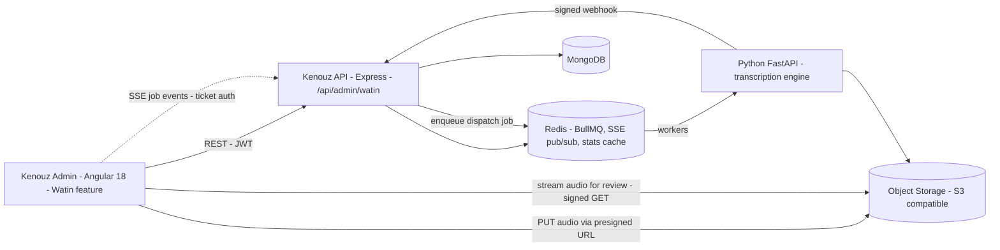
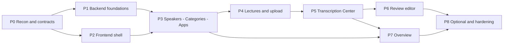

# Watin Admin Dashboard: Architecture & Implementation Plan

**Project:** Kenouz, Watin section inside the main Kenouz Admin
**Stack:** Angular 18 (standalone) · Node.js/Express · Mongoose/MongoDB · Python FastAPI (AI microservice)
**Version:** 1.0, 2026-10-02
**Audience:** Frontend, Backend, and the coding agent that will execute this plan
**Companion document:** `watin_dynamic_architecture.md` (data model, async transcription workflow, Python job contract). This plan **reuses** it and lists the **deltas** it requires in section 5.

---

## 0. Document Control

### 0.1 Goal

Build a **Watin Admin** area inside Kenouz Admin that lets editors and reviewers:

1. See system health at a glance (lectures, speakers, transcript segments, transcription status).
2. Manage speakers, categories, lectures (with long audio upload), and the visibility of ecosystem apps (KnoozBook, Mushaf Ward).
3. Send lectures to the Python engine for transcription, monitor jobs, **review** the result with a segment-aware audio player, edit text, and **approve and save**.

### 0.2 Assumptions (confirm in Phase 0)

| # | Assumption | If wrong |
|---|---|---|
| B1 | Kenouz Admin is an Angular 18 SPA with an app shell, JWT auth, and a permission model. | Adapt guards and the `PermissionService` (section 3.3). |
| B2 | Kenouz Admin already uses a UI library (Angular Material, PrimeNG, or another). **This plan does not impose one.** | Phase 0 decides; section 3.4 gives requirements any library must meet. |
| B3 | The Watin public-app backend from `watin_dynamic_architecture.md` is **fully or partly implemented** (models, queues, Python integration). | Phase 0 audits what exists; section 5 deltas may shrink or grow. |
| B4 | In "Overview", **"segments" (المقاطع)** means transcript segments (the timed text units produced by transcription). | If you meant lecture parts/clips, change one stat definition (section 3.5.1). |
| B5 | Admin UI language is Arabic (RTL) and/or English. Content fields are Arabic-first either way. | i18n scope changes; Arabic inputs always get explicit `dir="rtl"` (section 6.3). |
| B6 | Audio is in S3-compatible storage with presigned uploads (as in the companion document). | Upload manager (section 3.6.3) must change. |
| B7 | Daily verse management is **not in your list** but the public app depends on it. It is included as an optional page (section 3.9). | Remove it if managed elsewhere. |

### 0.3 Principles

1. **The server enforces everything.** Hiding a button is UX, never security.
2. **Server-driven tables.** Pagination, sorting, and filtering happen in MongoDB, never in the browser.
3. **Quran text integrity.** Verse text in transcripts comes from the reference corpus. The review editor **locks** verse segments; they change only through "Replace verse" (picked from the corpus) or "Revert to ASR text". No free typing into Quranic text.
4. **Autosave drafts, explicit approval.** Edits save as draft automatically. "Approve & Save" is a separate, audited action that marks the transcript reviewed.
5. **Optimistic concurrency.** Two editors never silently overwrite each other (transcript `revision`, section 5.2).
6. **Long work is asynchronous.** The UI never waits on Python. It starts a job and watches status.
7. **One pattern per concern.** Same table store, same dialog pattern, same error mapping everywhere.
8. **Match the existing Kenouz Admin.** Reuse its layout, theme, auth, HTTP conventions, and i18n. Introduce new libraries only when listed in section 3.4.

---

## 1. Information Architecture

### 1.1 Route map (lazy-loaded feature `watin`)

```
/admin/watin
├─ overview                          Dashboard (stats)
├─ speakers                          Speakers table + create/edit modal
├─ categories                        Categories table/tree + create/edit modal
├─ lectures                          Lectures table
│  ├─ new                            Create lecture (page form + audio upload)
│  └─ :lectureId                     Lecture detail (tabs: Details · Audio · Transcription · History)
├─ transcription                     Transcription Center
│  │                                 (tabs: Ready to transcribe · Jobs · Needs review)
│  └─ :lectureId/review              Review editor (smart segment player)
├─ apps                              Apps management (KnoozBook, Mushaf Ward)
├─ daily-verses                      (optional) Daily verse planner
└─ audit-log                         (optional) Change history
```

### 1.2 Permissions

| Permission | Allows |
|---|---|
| `watin:read` | See all Watin admin pages (read only) |
| `watin:edit` | Create/update speakers, categories, lectures, apps; upload audio; start transcription |
| `watin:review` | Edit transcripts, confirm/replace verses, **approve**, reopen |
| `watin:manage` | Delete/archive, publish/unpublish, change `transcriptPublic`, manage apps visibility |
| `watin:ops` | Cancel/retry jobs, see the raw job list and queue tools |

| Action | read | edit | review | manage | ops |
|---|:-:|:-:|:-:|:-:|:-:|
| View pages and stats | ✓ | ✓ | ✓ | ✓ | ✓ |
| Create/update speaker, category, lecture, app | | ✓ | | ✓ | |
| Upload audio, start transcription | | ✓ | | ✓ | |
| Edit transcript segments | | | ✓ | ✓ | |
| Approve / reopen transcript | | | ✓ | ✓ | |
| Publish / unpublish lecture, toggle `transcriptPublic` | | | | ✓ | |
| Archive / delete | | | | ✓ | |
| Cancel / retry job | | ✓ (own) | | ✓ | ✓ |
| Toggle app visibility | | | | ✓ | |

Map these onto Kenouz's existing roles (Phase 0). Frontend uses them only for UX (hide/disable); the API enforces them (section 5.3).

---

## 2. System Context



The admin UI talks **only** to the Kenouz API and object storage. It never calls Python.

---

## 3. Frontend Architecture (Angular 18)

### 3.1 Conventions (Angular 18)

| Topic | Rule |
|---|---|
| Components | **Standalone only.** No NgModules. `ChangeDetectionStrategy.OnPush` on every component. |
| Templates | Built-in control flow (`@if`, `@for` with `track`, `@switch`), stable in v18. `@defer` for heavy parts (charts, review editor internals). |
| State | **Signals** (`signal`, `computed`, `effect` sparingly). RxJS for streams and HTTP. Bridge with `toSignal` / `toObservable` from `@angular/core/rxjs-interop`. |
| DI | `inject()` function, not constructor injection. |
| Inputs/outputs | `@Input()/@Output()` or signal-based `input()/output()`. **Signal inputs are developer preview in v18**, so pick one style project-wide (default: decorators until Kenouz upgrades). |
| Routing | `provideRouter(routes, withComponentInputBinding())`, so route params arrive as inputs. Functional guards, resolvers, and `CanDeactivateFn`. Lazy `loadChildren` / `loadComponent`. |
| HTTP | `provideHttpClient(withInterceptors([...]))`. **Do not enable `withFetch()` for the upload client**: the fetch backend does not report upload progress, and presigned PUTs need progress events. |
| Forms | **Typed reactive forms** (`FormGroup<...>`, `NonNullableFormBuilder`). No template-driven forms. |
| Teardown | `takeUntilDestroyed()`; no manual `unsubscribe` boilerplate. |
| Types | `strict: true`; **no `any`**. API types **generated from OpenAPI** (companion doc, section 6.1), never hand-written. |
| Zone | Keep zone.js (zoneless is experimental in v18). Run high-frequency work (audio rAF loop) outside the zone (section 3.7.2). |
| Lint/format | `angular-eslint` + Prettier, same config as Kenouz. |

### 3.2 Folder structure

```
src/app/features/watin-admin/
├─ watin-admin.routes.ts
├─ shell/
│  └─ watin-admin-shell.component.ts          # sub-nav + <router-outlet>
├─ pages/
│  ├─ overview/            overview.page.ts, stat-card.component.ts, status-breakdown.component.ts, activity-feed.component.ts
│  ├─ speakers/            speakers.page.ts, speaker-form.dialog.ts
│  ├─ categories/          categories.page.ts, category-form.dialog.ts
│  ├─ lectures/            lectures.page.ts, lecture-form.page.ts, lecture-detail.page.ts, lecture-filters.component.ts
│  ├─ transcription/       transcription-center.page.ts, ready-queue.component.ts, jobs-monitor.component.ts,
│  │                       needs-review.component.ts, transcription-options.dialog.ts
│  ├─ review/              review.page.ts, segment-player.component.ts, segment-list.component.ts,
│  │                       segment-row.component.ts, verse-panel.component.ts, verse-picker.dialog.ts,
│  │                       approve.dialog.ts, review-toolbar.component.ts
│  ├─ apps/                apps.page.ts, app-form.dialog.ts
│  └─ daily-verses/        (optional)
├─ data-access/
│  ├─ speakers.api.ts, categories.api.ts, lectures.api.ts, uploads.api.ts,
│  ├─ transcription.api.ts, transcript.api.ts, apps.api.ts, stats.api.ts, daily-verses.api.ts
│  ├─ upload-manager.service.ts               # app-level, survives navigation
│  ├─ sse.service.ts                          # job events
│  └─ generated/                              # openapi-typescript output (do not edit)
├─ state/
│  ├─ server-table.store.ts                   # generic server-driven table
│  ├─ transcript-editor.store.ts              # review editor state + autosave
│  └─ segment-player.service.ts               # smart audio player
├─ shared/
│  ├─ ui/                  data-table, page-header, status-badge, confirm.dialog, empty-state, error-state,
│  │                       skeleton-rows, form-field, arabic-text-input, audio-preview
│  ├─ guards/              permission.guard.ts, unsaved-changes.guard.ts
│  ├─ directives/          has-permission.directive.ts
│  ├─ pipes/               duration.pipe.ts, bytes.pipe.ts, relative-time.pipe.ts
│  └─ util/                problem-details.ts (error to form mapping), binary-search.ts
└─ models/                 view models and enums (status vocab, section 12)
```

Anything that is not Watin-specific (`data-table`, `confirm.dialog`, `page-header`) should live in Kenouz's existing shared UI layer if it already has equivalents. Reuse before building.

### 3.3 Routing, guards, permissions

```ts
// app.routes.ts (main Kenouz Admin) — add one lazy entry
{
  path: 'watin',
  canMatch: [permissionGuard('watin:read')],
  loadChildren: () => import('./features/watin-admin/watin-admin.routes').then(m => m.WATIN_ADMIN_ROUTES),
},
```

```ts
// features/watin-admin/watin-admin.routes.ts
export const WATIN_ADMIN_ROUTES: Routes = [
  {
    path: '',
    loadComponent: () => import('./shell/watin-admin-shell.component').then(m => m.WatinAdminShellComponent),
    children: [
      { path: '', pathMatch: 'full', redirectTo: 'overview' },
      { path: 'overview',   title: 'Watin · Overview',   loadComponent: () => import('./pages/overview/overview.page').then(m => m.OverviewPage) },
      { path: 'speakers',   title: 'Watin · Speakers',   loadComponent: () => import('./pages/speakers/speakers.page').then(m => m.SpeakersPage) },
      { path: 'categories', title: 'Watin · Categories', loadComponent: () => import('./pages/categories/categories.page').then(m => m.CategoriesPage) },
      { path: 'lectures',   title: 'Watin · Lectures',   loadComponent: () => import('./pages/lectures/lectures.page').then(m => m.LecturesPage) },
      { path: 'lectures/new', canMatch: [permissionGuard('watin:edit')], loadComponent: () => import('./pages/lectures/lecture-form.page').then(m => m.LectureFormPage) },
      { path: 'lectures/:lectureId', loadComponent: () => import('./pages/lectures/lecture-detail.page').then(m => m.LectureDetailPage) },
      { path: 'transcription', title: 'Watin · Transcription', loadComponent: () => import('./pages/transcription/transcription-center.page').then(m => m.TranscriptionCenterPage) },
      {
        path: 'transcription/:lectureId/review',
        canMatch: [permissionGuard('watin:review')],
        canDeactivate: [unsavedChangesGuard],
        loadComponent: () => import('./pages/review/review.page').then(m => m.ReviewPage),
      },
      { path: 'apps', title: 'Watin · Apps', loadComponent: () => import('./pages/apps/apps.page').then(m => m.AppsPage) },
    ],
  },
];
```

```ts
// shared/guards/permission.guard.ts  (adapt to Kenouz's auth service)
export const permissionGuard = (perm: string): CanMatchFn => () => {
  const auth = inject(AuthService);           // placeholder: Kenouz's existing service
  const router = inject(Router);
  return auth.hasPermission(perm) || router.createUrlTree(['/forbidden']);
};
```

```ts
// shared/directives/has-permission.directive.ts — structural, for hiding actions
@Directive({ selector: '[hasPermission]', standalone: true })
export class HasPermissionDirective {
  private tpl = inject(TemplateRef); private vcr = inject(ViewContainerRef); private auth = inject(AuthService);
  @Input({ required: true }) set hasPermission(p: string) {
    this.vcr.clear(); if (this.auth.hasPermission(p)) this.vcr.createEmbeddedView(this.tpl);
  }
}
```

### 3.4 UI library requirements (library-agnostic)

Use whatever Kenouz Admin already uses. The library must provide the following; if something is missing, add the minimum.

| Need | Angular Material | PrimeNG |
|---|---|---|
| Server-side table with sort | `MatTable` + `MatSort` + `MatPaginator` | `p-table` (lazy mode) |
| Dialogs/modals (focus trap, ESC) | `MatDialog` | `DynamicDialog` / `p-dialog` |
| Drawer | `MatSidenav` | `p-sidebar` |
| Select with search, chips | `MatSelect`, `MatChips`, `MatAutocomplete` | `p-dropdown`, `p-multiSelect`, `p-chips` |
| Toasts | `MatSnackBar` | `p-toast` |
| Progress | `MatProgressBar` | `p-progressBar` |
| Tabs | `MatTabs` | `p-tabView` |
| Drag reorder | `@angular/cdk/drag-drop` | `p-orderList` or CDK |
| Charts | `ng2-charts` (Chart.js) or Kenouz's existing chart lib | same |

Extra dependencies this plan introduces: `@angular/cdk` (if not present), a chart library (reuse Kenouz's), and optionally `@microsoft/fetch-event-source` (only if the SSE ticket approach is rejected, section 3.8.2). Waveform rendering (wavesurfer.js) is **optional and deferred** (section 3.7.6).

### 3.5 Shared building blocks

#### 3.5.1 Generic server-driven table store

All list pages (speakers, categories, lectures, apps, jobs) share one pattern:

```ts
// state/server-table.store.ts  (illustrative; adapt types)
export interface TableQuery { page: number; pageSize: number; sort: string; q: string; filters: Record<string, string | string[] | null>; }
export interface Page<T> { data: T[]; meta: { page: number; pageSize: number; total: number; totalPages: number }; }

export abstract class ServerTableStore<T> {
  protected abstract fetch(q: TableQuery): Observable<Page<T>>;

  readonly query = signal<TableQuery>({ page: 1, pageSize: 20, sort: '-updatedAt', q: '', filters: {} });
  readonly rows = signal<T[]>([]);
  readonly total = signal(0);
  readonly loading = signal(false);
  readonly error = signal<ApiError | null>(null);
  readonly selection = signal<ReadonlySet<string>>(new Set());   // ids, for bulk actions

  constructor() {
    toObservable(this.query).pipe(
      debounceTime(200),
      tap(() => { this.loading.set(true); this.error.set(null); }),
      switchMap(q => this.fetch(q).pipe(
        map(p => ({ ok: true as const, p })),
        catchError((e: unknown) => of({ ok: false as const, e })),   // keep the stream alive after errors
      )),
      takeUntilDestroyed(),
    ).subscribe(r => {
      this.loading.set(false);
      if (r.ok) { this.rows.set(r.p.data); this.total.set(r.p.meta.total); }
      else this.error.set(toApiError(r.e));
    });
  }

  setPage(page: number) { this.query.update(q => ({ ...q, page })); }
  setSort(sort: string) { this.query.update(q => ({ ...q, sort, page: 1 })); }
  setSearch(q: string)  { this.query.update(s => ({ ...s, q, page: 1 })); }
  setFilter(key: string, v: string | string[] | null) { this.query.update(s => ({ ...s, filters: { ...s.filters, [key]: v }, page: 1 })); }
  reload() { this.query.update(q => ({ ...q })); }               // new object identity triggers refetch
}
```

Requirements on top of this store:

- **URL sync:** query state mirrors to route query params (`?page=2&sort=-updatedAt&status=draft`) so refresh and back/forward work.
- **Request cancellation** via `switchMap`; stale responses never overwrite newer ones.
- **Preferences:** page size and visible columns persisted per user in `localStorage`.
- **Selection** survives page changes only when explicitly enabled.

#### 3.5.2 Dialog (modal) pattern

- A dialog component receives `{ mode: 'create' | 'edit', entity? }` and returns the saved entity (or `undefined` on cancel).
- Typed form, submit disabled while invalid or saving, a spinner on the primary button.
- **Server validation errors** (`problem+json` with `errors[]`) map to controls by `field`; unmapped errors show in a banner at the top of the dialog.
- Closing with unsaved changes asks "Discard changes?".
- Sizes: small (confirm), medium (entity forms), large (picker). Lecture editing is **not** a modal (section 3.6.2).

```ts
// shared/util/problem-details.ts
export function applyServerErrors(form: FormGroup, err: ApiError): string[] {
  const unmapped: string[] = [];
  for (const e of err.errors ?? []) {
    const c = form.get(e.field);
    if (c) c.setErrors({ server: e.message }); else unmapped.push(e.message);
  }
  if (!err.errors?.length) unmapped.push(err.message);
  return unmapped;
}
```

#### 3.5.3 Shared components

| Component | Responsibility |
|---|---|
| `PageHeaderComponent` | Title, subtitle, breadcrumbs, primary action slot |
| `DataTableComponent` | Wraps the UI library table; inputs: `columns`, `rows`, `total`, `loading`, `selectable`; outputs: `sortChange`, `pageChange`, `rowClick`; skeleton rows, empty and error states built in |
| `StatusBadgeComponent` | One component for all status vocabularies (section 12) with consistent colors and icons |
| `ConfirmDialog` | Standard confirmation; optional type-to-confirm for destructive actions |
| `FormField` | Label, hint, error, required marker; consistent spacing |
| `ArabicTextInput` | Input/textarea with `dir="rtl"`, `lang="ar"`, Arabic font; **never normalizes** typed text |
| `AudioPreviewComponent` | Minimal `<audio>` wrapper for lecture form |
| `EmptyState` / `ErrorState` / `SkeletonRows` | Uniform states |

### 3.6 Pages, one by one

For each page: purpose, layout, components, data, interactions, states, API (paths relative to `/api/admin/watin`, full list in section 5.4).

#### 3.5.1 Overview (Dashboard)

**Purpose:** at-a-glance health and a work queue.

**Layout (desktop):**

```
┌ Stat cards (4–6) ─────────────────────────────────────────────────────┐
│ Lectures │ Speakers │ Categories │ Transcript segments │ Awaiting review │ Failed jobs │
├ Transcription status ────────────┬ Review status ───────────┬ Active jobs (live) ───────┤
│ stacked bar / donut by status    │ unreviewed / in review / │ list w/ progress bars     │
│                                  │ reviewed                 │                           │
├ Recent activity (audit feed) ────┴──────────────────────────┴───────────────────────────┤
└──────────────────────────────────────────────────────────────────────────────────────────┘
```

| Card/section | Source | Click behavior |
|---|---|---|
| Lectures (with draft/published/archived split) | `stats.lectures` | `/lectures` with that filter |
| Speakers | `stats.speakers` | `/speakers` |
| Categories | `stats.categories` | `/categories` |
| Transcript segments | `stats.segments` (sum of `transcription.summary.segmentCount`, active transcripts) | none |
| Transcription status distribution | `stats.transcription` (`not_requested, pending, processing, completed, failed, canceled`) | `/lectures?transcriptionStatus=…` |
| Awaiting review | completed AND `reviewStatus != reviewed` | `/transcription` tab "Needs review" |
| Failed jobs | `transcription.status = failed` | `/transcription` tab "Jobs" filtered |
| Total audio hours, storage used | `stats.audio` | none |
| Active jobs | live (SSE, with polling fallback) | opens review/lecture |
| Recent activity | audit log, last 10 | opens entity |

- Data: `GET /stats` (cached server-side 30 to 60 s) plus live job events.
- Charts load with `@defer (on viewport)`.
- States: skeleton cards, partial-failure tolerance (a failing widget shows its own error state, not a blank page).

#### 3.6.1 Speakers (CRUD)

- **Table columns:** avatar, name (ar/en), title (honorific), lectures count, status, updated, actions.
- **Toolbar:** search, status filter, "Add speaker".
- **Create/Edit:** modal with fields `name.ar` (required), `name.en`, `slug` (auto-generated from name, editable, unique), `title`, `bio`, `avatar` (small image upload via presigned URL), `status`.
- **Delete:** archive by default. If lectures reference the speaker, the API returns `409 SPEAKER_HAS_LECTURES { count }`; the UI offers "Reassign lectures to…" (speaker select) then retries with `?reassignTo=`.
- **Row actions:** Edit, Archive/Restore, View lectures (links to `/lectures?speakerId=`).

#### 3.6.2 Categories (CRUD)

- **View:** two-level tree table (parent rows expandable), drag-and-drop reordering within a level (CDK drag-drop), saved via `POST /categories/reorder`.
- **Columns:** icon, name (ar/en), slug, parent, lectures count (published), status, actions.
- **Create/Edit modal:** `name.ar` (required), `name.en`, `slug`, `description`, `parentId` (only root categories selectable, depth max 2), `icon.key` (picker from the design system's icon set), `colorToken` (select: forest/olive/sand/cream/sage), `status`.
- **Rules:** a category with children cannot become a child; archiving a category with published lectures returns `409` and offers reassignment (`?reassignTo=`).
- Taxonomy suggestion (from the product design): `quran`, `qiraat`, `tafsir`, `fiqh`, `sharia`, `arabic`. Lectures can have 1 to 5 categories.

#### 3.6.3 Lectures (CRUD and upload)

**List (`/lectures`):**

| Column | Notes |
|---|---|
| Title (+ cover thumb) | Click opens detail |
| Speaker | Name |
| Categories | First 2 chips, "+N" |
| Duration | `mm:ss` or `h:mm:ss` |
| Publish status | `draft / published / archived` |
| Transcription | Status badge; progress mini-bar while `processing` |
| Review | `unreviewed / in_review / reviewed` (only when transcription is `completed`) |
| Updated | Relative time |
| Actions | Menu (see below) |

- **Filters:** search (title), publish status, transcription status, review status, category, speaker.
- **Bulk actions:** publish, unpublish, archive, "Send to transcription" (opens options dialog, section 3.7).
- **Row actions:** Open, Edit, Transcribe (if eligible), Review (if completed), Publish/Unpublish, Archive, Delete (drafts only).

**Create/Edit page (not a modal):** a full page with three sections, because it contains a long upload, many fields, and needs to survive navigation:

1. **Details:** title (required), description, speaker (searchable select), categories (multi-select, 1 to 5), primary category, tags, series (name and order), recorded date.
2. **Audio:** the uploader (below), preview player, metadata readout (duration, size, format) after verification.
3. **Publishing:** status, schedule date, `transcriptPublic` (disabled until a transcript is approved).

Saving metadata and uploading audio are **independent**: create the draft first (`POST /lectures`), then upload against its `id`. The user may leave the page while the upload continues.

**Upload manager (app-level service, survives navigation):**

```ts
@Injectable({ providedIn: 'root' })
export class UploadManager {
  readonly uploads = signal<UploadItem[]>([]);   // { id, lectureId, file, state, progress, error }
  enqueue(lectureId: string, file: File): void { /* validate -> init -> upload -> complete */ }
  cancel(id: string): void { /* abort XHR + POST /uploads/audio/abort */ }
}
```

- **Floating upload tray** (bottom corner) shows all uploads with progress, cancel, retry.
- **Flow:** client validation (MIME in allowed list, size ≤ configured max) → `POST /uploads/audio/init` → upload → `POST /uploads/audio/complete` → server verifies the object → lecture `audio.uploadStatus = verified`.
- **Small files (below a threshold):** one presigned `PUT`. **Large files:** multipart, 3 to 4 parts in parallel, per-part retry with backoff, `ETag` per part collected for `complete`.
- **Resume:** persist `{uploadId, completedParts}` in IndexedDB so a refresh can resume a multipart upload.
- **Progress:** XHR `upload.onprogress` (or `HttpClient` with `reportProgress: true` on the default XHR backend).
- The audio **duration read in the browser is informational only**; the engine/ffprobe value is stored as truth.

Two classic pitfalls (must be handled in code and in storage configuration):

1. **The auth interceptor must not attach `Authorization` to presigned URLs.** Skip it for the storage host, otherwise the signature check fails with 403.

```ts
export const authInterceptor: HttpInterceptorFn = (req, next) => {
  if (isStorageUrl(req.url)) return next(req);            // presigned URL: add NOTHING
  return next(req.clone({ setHeaders: { Authorization: `Bearer ${inject(AuthService).token()}` } }));
};
```

2. **Bucket CORS** must allow `PUT` from the admin origin, allow the needed headers, and **expose the `ETag` header**, or multipart completion cannot read part ETags.

#### 3.6.4 Lecture detail (`/lectures/:lectureId`)

Tabs: **Details** (read view and edit link), **Audio** (player, metadata), **Transcription** (status card with stage, progress, elapsed time, error; actions Start / Cancel / Retry / Open review; version history), **History** (audit entries for this lecture).

### 3.7 Transcription Center

**Purpose:** pick lectures, send them to Python through the queue, watch progress, and move finished work to review.

**Tabs:**

| Tab | Content |
|---|---|
| **Ready to transcribe** | Lectures with `audio.uploadStatus = verified` and `transcription.status` in `not_requested, failed, canceled`. Multi-select. Primary action: **"Transcribe selected"**. |
| **Jobs** | Lectures with `pending` or `processing` (plus recent `failed`). Live progress, stage, elapsed time, Cancel/Retry. |
| **Needs review** | `completed` and `reviewStatus != reviewed`. Primary action: **"Review"** opens the editor. |

#### 3.7.1 Start transcription

Row or bulk action opens **`TranscriptionOptionsDialog`**:

| Field | Values | Notes |
|---|---|---|
| Lecture type | General, Tafsir, Tadabbur, Tajweed/Qira'at | Controls pipeline mode |
| Riwaya | Select with status badge (verified / experimental / unavailable) | Shown for Tafsir, Tadabbur, Tajweed; multi-select allowed only for Tajweed. Unavailable riwayat disabled. |
| Detect verses | Toggle | Default on for Quran-related types |
| Merge repeated recitations | Toggle | Tajweed only |
| Diacritization | Off / Automatic / Automatic without case endings | Applies to non-Quran speech only; shows a note that output is automatic and unverified |
| Dialect hint | Mixed / MSA / Egyptian | |

- Submit calls `POST /transcription` (single) or `POST /transcription/batch` (many). Both return `202 Accepted`; the UI moves the rows to the Jobs tab immediately (optimistic), then reconciles with the response.
- Rows that cannot start show the reason (no verified audio, already running, riwaya unavailable).
- **No time estimate** is shown until real processing-speed data exists; then display a median-based estimate computed from completed jobs.

#### 3.7.2 Live job monitoring

- **Primary:** SSE stream (section 3.8.2). **Fallback:** poll `GET /transcription/jobs?status=pending,processing` every 5 s (back off to 15 s).
- Each row shows: status badge, stage label, a progress bar, elapsed time, last heartbeat, and actions.
- A job without a heartbeat for several minutes shows a "Stalled?" hint (server-side reconciler decides the final status).
- Completion triggers a toast: "Transcription finished: {title}. Review now" with a link.

### 3.8 Review Editor (`/transcription/:lectureId/review`)

This is the most complex screen. It has three parts: the **Smart Segment Player**, the **Segment List**, and the **Verse Panel**.

#### 3.8.1 Layout

Desktop (≥1280 px): two panes. Mobile/tablet: stacked with a sticky player bar.

```
┌ Header: lecture title · speaker · status · [Save state: Saved 12:03] · [Approve & Save] ┐
├ Smart Segment Player (sticky) ───────────────────────────────────────────────────────────┤
│  ⏮ seg   ▶/⏸   seg ⏭   ⟲ replay seg   🔁 loop seg   ⏩ auto-advance   speed 1.0×   12:40 / 58:14 │
│  seek bar with segment boundaries                                                          │
├ Segment List ────────────────────────────────────┬ Verse / Details panel (selected) ──────┤
│ #17  12:33–12:41  speech                         │ Verse: Al-Fatiha 1:1–1:3               │
│  [ editable Arabic text .................... ]   │ Riwaya: Hafs   Score 0.97   Status ●   │
│ #18  12:41–12:49  recitation 🔒  ● needs review  │ Reference text (read only)             │
│  [ reference verse text (locked) ........... ]   │ ASR text (for comparison)              │
│ #19  ...                                         │ [Confirm] [Replace verse…] [Revert]    │
└──────────────────────────────────────────────────┴────────────────────────────────────────┘
```

In RTL the panes mirror automatically (use logical CSS properties: `margin-inline-start`, `padding-inline-end`, `inset-inline`).

#### 3.8.2 Smart Segment Player

The player plays the **whole lecture** but understands segments.

| Capability | Behavior |
|---|---|
| Play segment | Click a segment's play button or press `Enter` on a focused row: seek to `startSec − pad`, play, stop at `endSec + pad` (default pad 0.2 s, configurable 0 to 1 s) |
| Replay segment | `R`: restart the current segment |
| Loop segment | Toggle: when the end is reached, jump back to the start |
| Auto-advance | Toggle: when the end is reached, play the next segment |
| Previous / next segment | `Alt+←` / `Alt+→` (mirrored in RTL) |
| Follow along | The active segment is highlighted and scrolled into view (unless the user is scrolling manually) |
| Speed | 0.5× to 2×, remembered per user; pitch preserved (`preservesPitch`) |
| Seek bar | Shows segment boundaries as ticks; click seeks and updates the active segment |
| Keyboard | Full set in Appendix C; shortcuts are disabled while typing in a text field |

**Precision:** the `timeupdate` event fires only a few times per second, which is too coarse to stop exactly at a segment end. Use a `requestAnimationFrame` loop **outside the Angular zone** while playing, and push signal updates back into the zone only when the active segment changes or at a throttled rate (about 5 Hz) for the clock display.

```ts
// state/segment-player.service.ts (illustrative)
@Injectable()
export class SegmentPlayerService {
  private zone = inject(NgZone);
  private audio = new Audio();                       // preload="metadata"
  private segments: ReadonlyArray<{ idx: number; startSec: number; endSec: number }> = [];
  private stopAt: number | null = null;
  private raf = 0;
  private lastClockPush = 0;

  readonly playing = signal(false);
  readonly currentTime = signal(0);
  readonly activeIdx = signal<number | null>(null);
  readonly rate = signal(1);
  readonly loopSegment = signal(false);
  readonly autoAdvance = signal(false);
  readonly padSec = signal(0.2);

  load(url: string, segs: typeof this.segments) { this.audio.src = url; this.segments = segs; }

  playSegment(idx: number) {
    const s = this.segments.find(x => x.idx === idx); if (!s) return;
    this.audio.currentTime = Math.max(0, s.startSec - this.padSec());
    this.stopAt = s.endSec + this.padSec();
    void this.audio.play();
    this.startLoop();
  }

  private startLoop() {
    this.zone.runOutsideAngular(() => {
      cancelAnimationFrame(this.raf);
      const tick = () => {
        const t = this.audio.currentTime;
        const idx = findSegmentIdx(this.segments, t);           // binary search on startSec
        if (idx !== this.activeIdx()) this.zone.run(() => this.activeIdx.set(idx));
        if (performance.now() - this.lastClockPush > 200) { this.lastClockPush = performance.now(); this.zone.run(() => this.currentTime.set(t)); }
        if (this.stopAt !== null && t >= this.stopAt) {
          if (this.loopSegment() && this.activeIdx() !== null) return void this.zone.run(() => this.playSegment(this.activeIdx()!));
          if (this.autoAdvance()) return void this.zone.run(() => this.playNext());
          this.audio.pause(); this.stopAt = null; this.zone.run(() => this.playing.set(false)); return;
        }
        if (!this.audio.paused) this.raf = requestAnimationFrame(tick);
      };
      this.raf = requestAnimationFrame(tick);
    });
  }
  // playNext(), togglePlay(), seek(), setRate(), ngOnDestroy(): cancel rAF, pause, release src
}
```

**Signed URL expiry:** the review page gets the audio URL from `GET /lectures/:id/audio-url` (`{ url, expiresAt }`). Refresh it before expiry and on any `error` event (re-fetch the URL, restore `currentTime`).

**Timestamp drift risk:** variable-bitrate MP3 files without a proper index can seek inaccurately in browsers, so segment times (computed on the decoded audio) may drift. Mitigation: have the engine produce a **constant-bitrate review copy** during preprocessing and serve that for review (section 9, risk R5). Verify with a real file in Phase 6.

**Autoplay policy:** playback always starts from a user gesture (click or key), so no special handling is needed.

#### 3.8.3 Segment List

- **Rendering:** a long lecture can have 1,000+ segments with **variable height** (editable text). A fixed-size virtual scroll does not fit. Use **windowed rendering by pages of about 50 segments** (render the active page ±1), `@for` with `track seg.idx`, an `OnPush` row component, and CSS `content-visibility: auto` with `contain-intrinsic-size` on rows. Provide a "Jump to time" input and a mini page navigator.
- **Row content:** index, time range (click = play segment), kind chip, the text area, status chips (`edited`, `automatic diacritization`, verse status), lock icon for verse segments.
- **Filters:** "Needs review only", "Edited only", "Verses only", "Low confidence (below a threshold)". Counter badges show remaining unresolved items.
- **Editing rules** (enforced by the UI **and** the API):

| Segment type | What the editor allows |
|---|---|
| Speech (no verse matches) | Free text editing (Arabic text input, diacritics preserved exactly as typed); timing nudge |
| Recitation with verse match | Text is **locked** (reference text). Actions: **Confirm**, **Replace verse…** (corpus picker), **Revert to ASR text** |
| After "Revert to ASR text" | Becomes a speech segment; free editing allowed |

- **Never normalize** what the reviewer types (no stripping diacritics, no character replacement). Normalization exists only for matching and search on the server.
- Optional later: split segment at the cursor, merge with the next segment, delete segment.

#### 3.8.4 Verse Panel and Verse Picker

- Shows each match: surah/ayah range, riwaya (with verified/experimental badge), score, match type (`exact / normalized / partial / fuzzy`), status (`auto / needs_review / confirmed / corrected`), the **reference text**, and the **ASR text** side by side.
- **Confirm**: marks `confirmed`.
- **Replace verse…**: opens `VersePickerDialog` (surah select, ayah from/to, riwaya select, live preview from `GET /quran/verses/preview`); the server fills the text from the corpus, never from the client.
- **Revert to ASR text**: drops matches, restores raw ASR text.

#### 3.8.5 Editor state, autosave, conflicts

```ts
// state/transcript-editor.store.ts (shape; implement with signals)
@Injectable()
export class TranscriptEditorStore {
  readonly segments   = signal<SegmentVm[]>([]);
  readonly revision   = signal(0);                          // server revision the local copy is based on
  readonly pending    = signal<Map<number, SegmentChange[]>>(new Map());
  readonly dirty      = computed(() => this.pending().size > 0);
  readonly saveState  = signal<'idle' | 'saving' | 'saved' | 'error' | 'conflict'>('idle');
  readonly unresolved = computed(() => this.segments().filter(s => s.hasUnresolvedMatch).length);

  edit(change: SegmentChange) {
    // 1) apply locally (optimistic), 2) merge into pending by idx, 3) schedule autosave
  }
  // autosave: debounce 2 s after the last change, serialize with concatMap,
  // send { baseRevision, changes[] } (max 100 changes), on 200 set revision = response.revision and
  // clear only the changes that were sent; on 409 REVISION_CONFLICT -> saveState = 'conflict'
}
```

| Concern | Behavior |
|---|---|
| Autosave | 2 s after the last edit, and on blur of a row; status text in the header ("Saving…", "Saved 12:03", "Failed, retrying") |
| Offline/failed save | Changes stay in `pending`; exponential backoff retry; "Retry now" button |
| Conflict (`409`) | Dialog: "This transcript was changed by someone else." Options: reload (discard local) or copy local changes then reload. Never overwrite silently |
| Unsaved changes | `CanDeactivateFn` guard + `beforeunload` while `dirty` |
| Undo/redo | Optional session-level stack (`Ctrl+Z`/`Ctrl+Shift+Z`) for text edits |
| Locking (optional, later) | Soft edit lock with heartbeat so a second reviewer sees "Being reviewed by X" |

#### 3.8.6 Approve & Save

Opens `ApproveDialog`:

- Summary: segments, edited count, verse matches by status, **unresolved `needs_review` count**.
- If unresolved items exist: warning list with "Go to first" and a checkbox "I understand and approve anyway" (sends `acknowledgeUnresolved: true`).
- Options: "Make transcript public in the Watin app" (requires `watin:manage`; sets `transcriptPublic`).
- **Calls `POST /lectures/:id/transcript/approve`** with `{ baseRevision, acknowledgeUnresolved, makePublic }`. The server verifies the revision, sets `reviewStatus = reviewed`, `reviewedBy`, `reviewedAt`, writes an audit entry, and returns the new revision.
- After approval: the transcript stays editable (edits keep autosaving) but any new edit moves `reviewStatus` back to `in_review` until approved again, **or** the page shows "Reopen" (choose one behavior in Phase 0; recommended: edits after approval auto-reopen and show a banner).

**Why not a single "save everything on approve":** the transcription result is already persisted in MongoDB when ingestion finishes (companion doc, section 4.7), as `unreviewed`. Autosave protects the reviewer's work from browser crashes; "Approve & Save" is the editorial sign-off. This keeps one source of truth and avoids a client-side-only draft.

### 3.9 Apps Management

**Purpose:** control which ecosystem apps appear in the Watin user app, where, and with which links (initially KnoozBook and Mushaf Ward).

- **Table:** icon, name, key, platforms, placements, enabled switch, sort order (drag), updated, actions.
- **Quick toggle:** the enabled switch calls `PATCH /apps/:id` immediately (optimistic with rollback).
- **Create/Edit modal fields:**

| Field | Notes |
|---|---|
| `key` | Unique slug (`knoozbook`, `mushaf-ward`); immutable after creation |
| `name.ar`, `name.en`, `tagline.ar/en` | Display text |
| `icon` | Design-system key or uploaded image |
| `links.web` | `https://` only |
| `links.android` | `https://play.google.com/…` or `market://…` |
| `links.ios` | `https://apps.apple.com/…` |
| `links.deepLink` | Custom scheme (`^[a-z][a-z0-9+.-]*://`) |
| `openMode` | `external_browser`, `in_app_browser`, `deep_link_then_store` |
| `visibility.platforms` | Subset of `web`, `android`, `ios` |
| `visibility.placements` | Subset of `home`, `drawer`, `more` |
| `status` | `draft / published / archived` |
| `sortOrder` | Via drag reorder |

- **Preview card** in the modal shows how the app tile will look in Watin.
- **Validation (server-enforced):** reject `javascript:`, `data:`, `file:`, and other non-allowlisted schemes; require HTTPS for web links; max lengths. **The server never fetches these URLs** (no link checker in v1, to avoid SSRF).
- Public consumption: `GET /api/watin/apps?platform=android` returns only enabled, published apps for that platform, sorted.
- Do not invent URLs; the initial seed uses placeholders until the real links are provided.

### 3.10 Optional pages

- **Daily verse planner (`/daily-verses`):** month calendar; pick surah/ayah/riwaya from the corpus preview (the verse text is **never typed**; the server fills `textSnapshot`); mark evergreen entries (fallback pool); bulk schedule. The public app always needs a fallback source, so this page should ship before launch.
- **Audit log (`/audit-log`):** filterable table (actor, entity, action, date) with diff view.

---

## 4. Real-time, Errors, and Cross-cutting Frontend Concerns

### 4.1 Error handling

- One interceptor maps `application/problem+json` to `ApiError { status, code, message, errors[], retryable }`.
- UI messages come from `code` (not raw server text) via i18n keys, with a generic fallback.
- Network errors on GET: up to 2 retries with jittered backoff. **No automatic retry for POST/PUT/PATCH/DELETE.**
- `401`: refresh token flow or redirect to login (Kenouz's existing behavior). `403`: "You don't have permission". `409`: entity-specific handling. `422`: map to form fields.

### 4.2 SSE for job events

`EventSource` cannot set an `Authorization` header. Use one of:

1. **One-time ticket (recommended):** `POST /events-ticket` returns `{ ticket }` valid about 30 s; the client opens `EventSource('/api/admin/watin/transcription/events?ticket=…')`.
2. `@microsoft/fetch-event-source`, which supports headers.
3. Polling only (always available as a fallback).

```ts
// data-access/sse.service.ts (illustrative)
@Injectable({ providedIn: 'root' })
export class SseService {
  private api = inject(TranscriptionApi);
  private zone = inject(NgZone);

  jobEvents(): Observable<JobEvent> {
    return new Observable<JobEvent>(sub => {
      let es: EventSource | null = null; let stopped = false; let attempt = 0;
      const open = async () => {
        const { ticket } = await firstValueFrom(this.api.eventsTicket());
        es = new EventSource(`/api/admin/watin/transcription/events?ticket=${ticket}`);
        es.addEventListener('update', (e) => this.zone.run(() => sub.next(JSON.parse((e as MessageEvent).data))));
        es.onopen = () => { attempt = 0; };
        es.onerror = () => { es?.close(); if (!stopped) setTimeout(open, Math.min(30_000, 1000 * 2 ** attempt++)); };
      };
      void open();
      return () => { stopped = true; es?.close(); };
    });
  }
}
```

The server sends a state snapshot on connect, keepalive comments every 25 s, and disables proxy buffering for this route.

### 4.3 Performance

- Feature is lazy-loaded as its own chunk; charts and the review editor use `@defer`.
- `OnPush` everywhere; `track` on every `@for`; no function calls in templates (use `computed`).
- The review page keeps heavy computations (segment lookup) in services, not templates.
- Transcript payloads are fetched once per version (immutable `?v=`), then edited locally.
- Measure bundle sizes in CI against Kenouz's existing budgets; do not invent new numbers here.

### 4.4 Accessibility and i18n

- WCAG AA contrast, visible focus, full keyboard operation of tables, dialogs, and the player.
- Dialogs trap focus and restore it to the trigger on close.
- Job progress uses `aria-live="polite"`; icon-only buttons have labels.
- Icons that indicate direction mirror in RTL.
- All strings go through Kenouz's i18n mechanism; Arabic content fields set `dir="rtl"` and `lang="ar"` regardless of UI language, with bidi isolation (`<bdi>`) when mixing Latin text.

---

## 5. Backend Plan (Node.js / Express / Mongoose)

### 5.1 Module layout (inside the existing Kenouz backend)

```
src/modules/watin/
├─ models/            WatinCategory, WatinSpeaker, WatinLecture, WatinTranscript, WatinDailyVerse,
│                     WatinQuranVerse, WatinApp (new), WatinAuditLog (new)
├─ admin/
│  ├─ routes.ts       # mounts everything under /api/admin/watin
│  ├─ controllers/    speakers, categories, lectures, uploads, transcription, transcript, apps, stats, dailyVerses
│  ├─ validators/     zod schemas per route
│  └─ middleware/     requirePermission, validate, paginate, audit, problem-details error handler
├─ public/            (already built)
├─ internal/          webhook (already built)
├─ services/          lecture.service, transcript.service, stats.service, storage.service, audit.service
└─ workers/           (already built: dispatch, ingest, reconcile)
```

Controllers stay thin: parse, call a service, map to a DTO. Business rules (dependency checks, state transitions, counter updates) live in services, with unit tests.

### 5.2 Deltas to `watin_dynamic_architecture.md`

| # | Delta | Reason |
|---|---|---|
| D1 | **`WatinApp`** model and public endpoint `GET /api/watin/apps` | Apps management |
| D2 | **`revision: Number`** on `WatinTranscript` (starts at 1, `$inc` on every edit) | Optimistic concurrency for the review editor |
| D3 | `transcription.reviewedBy`, `transcription.reviewedAt` on the lecture | Approval audit |
| D4 | **Bulk segment changes endpoint** (op-based) and **approve / reopen** endpoints | Review workflow |
| D5 | **Global admin SSE stream** `GET /transcription/events` (Redis channel `watin:admin:transcription`) in addition to the per-lecture channel; `POST /events-ticket` | Jobs monitor and dashboard |
| D6 | **`GET /stats`** (aggregation + short Redis cache) | Overview page |
| D7 | **`GET /lectures/:id/audio-url`** returning a short-lived signed GET | Review player |
| D8 | **Batch start** `POST /transcription/batch` | Multi-select in the Transcription Center |
| D9 | **`WatinAuditLog`** collection and `audit()` middleware | Activity feed, accountability |
| D10 | Admin list endpoints use offset pagination (`page`, `pageSize`) with a hard cap on `pageSize` | Table UX |
| D11 | `PUT` for entity form saves, `PATCH` for targeted partial changes (toggle, reorder, segment ops) | Aligns with the requested REST verbs; replaces the PATCH-for-forms wording in the companion doc |

D2/D3 schema changes:

```ts
// WatinTranscript: add
revision: { type: Number, default: 1 },

// WatinLecture.transcription: add
reviewedBy: { type: Schema.Types.ObjectId, ref: 'User' },
reviewedAt: { type: Date },
```

D1 schema:

```ts
// modules/watin/models/WatinApp.ts
const LocalizedString = new Schema({ ar: { type: String, required: true, trim: true, maxlength: 200 }, en: { type: String, trim: true, maxlength: 200 } }, { _id: false });

const WatinAppSchema = new Schema({
  key: { type: String, required: true, unique: true, lowercase: true, trim: true, match: /^[a-z0-9]+(?:-[a-z0-9]+)*$/, immutable: true },
  name: { type: LocalizedString, required: true },
  tagline: { type: LocalizedString },
  icon: { key: String, url: String },
  links: {
    web:      { type: String, validate: (v: string) => !v || /^https:\/\//i.test(v) },
    android:  { type: String, validate: (v: string) => !v || /^(https:\/\/play\.google\.com\/|market:\/\/)/i.test(v) },
    ios:      { type: String, validate: (v: string) => !v || /^https:\/\/apps\.apple\.com\//i.test(v) },
    deepLink: { type: String, validate: (v: string) => !v || (/^[a-z][a-z0-9+.-]*:\/\//i.test(v) && !/^(javascript|data|file|vbscript):/i.test(v)) },
  },
  openMode: { type: String, enum: ['external_browser', 'in_app_browser', 'deep_link_then_store'], default: 'external_browser' },
  visibility: {
    platforms:  { type: [String], enum: ['web', 'android', 'ios'], default: ['web', 'android', 'ios'] },
    placements: { type: [String], enum: ['home', 'drawer', 'more'], default: ['more'] },
  },
  sortOrder: { type: Number, default: 0 },
  status: { type: String, enum: ['draft', 'published', 'archived'], default: 'draft' },
  createdBy: { type: Schema.Types.ObjectId, ref: 'User' },
  updatedBy: { type: Schema.Types.ObjectId, ref: 'User' },
}, { timestamps: true, collection: 'watin_apps' });

WatinAppSchema.index({ status: 1, sortOrder: 1 });
```

D9 schema (kept small; store diffs, not full documents):

```ts
const WatinAuditLogSchema = new Schema({
  actorId: { type: Schema.Types.ObjectId, ref: 'User', required: true },
  action: { type: String, required: true },          // e.g. speaker.update, transcript.approve
  entity: { type: String, required: true },          // speaker | category | lecture | transcript | app | daily_verse
  entityId: { type: Schema.Types.ObjectId, required: true },
  changes: { type: Schema.Types.Mixed },             // { field: { from, to } } for small fields; counts for bulk ops
  ip: String, userAgent: String,
  at: { type: Date, default: Date.now },
}, { collection: 'watin_audit_logs' });
WatinAuditLogSchema.index({ entity: 1, entityId: 1, at: -1 });
WatinAuditLogSchema.index({ at: -1 });
// Optionally add a TTL index if retention is limited
```

Audit scope: record create/update/delete/archive/publish, upload completion, transcription start/cancel/retry, approve/reopen, and the **summary** of segment batches (counts), never one entry per keystroke.

### 5.3 Conventions

- **Base path:** `/api/admin/watin`. If the companion plan's `/v1` suffix was already implemented, keep it and treat every path below as relative to that base.
- **Auth:** Kenouz JWT middleware, then `requirePermission(...)` per route (section 1.2).
- **Validation:** zod (or Joi, whichever Kenouz uses) on params, query, and body; unknown fields rejected.
- **Response envelope:** `{ data, meta? }`. **Errors:** RFC 9457 `application/problem+json`:

```json
{
  "type": "https://kenouz.example/problems/validation",
  "title": "Validation failed",
  "status": 422,
  "code": "VALIDATION_FAILED",
  "errors": [{ "field": "name.ar", "code": "REQUIRED", "message": "Arabic name is required" }],
  "requestId": "…"
}
```

- **Table query params:** `page` (1-based), `pageSize` (default 20, max 100), `sort` (`field` or `-field`), `q`, plus entity filters. Response `meta: { page, pageSize, total, totalPages }`. Sort fields come from an allowlist per entity.
- **Mongo safety:** build queries from validated values only; escape regex in `q`; never pass request objects into `find()` directly (NoSQL operator injection).
- **Idempotency:** `Idempotency-Key` supported on `POST /lectures` and `POST /transcription*`.
- **Soft removal:** `DELETE` means archive (sets `status: 'archived'`) except where stated.
- **Readonly fields** (`createdAt`, counters, `transcription.*`) are ignored on `PUT`.

```ts
// admin/routes.ts (skeleton)
const r = Router();
r.use(authenticate);                                                    // Kenouz JWT
r.get ('/speakers',      requirePermission('watin:read'),   validate(speakerListQuery), ctrl.speakers.list);
r.post('/speakers',      requirePermission('watin:edit'),   validate(speakerBody),      audit('speaker.create'), ctrl.speakers.create);
r.put ('/speakers/:id',  requirePermission('watin:edit'),   validate(speakerBody),      audit('speaker.update'), ctrl.speakers.update);
r.delete('/speakers/:id',requirePermission('watin:manage'), validate(deleteQuery),      audit('speaker.archive'), ctrl.speakers.archive);
// …same shape for categories, lectures, apps
export default r;     // app.use('/api/admin/watin', r)
```

### 5.4 Endpoint reference (all under `/api/admin/watin`)

#### Overview

| Method | Path | Permission | Purpose |
|---|---|---|---|
| GET | `/stats` | read | Aggregated dashboard statistics |
| GET | `/activity?limit=10` | read | Recent audit entries |

#### Speakers

| Method | Path | Permission | Purpose / notes |
|---|---|---|---|
| GET | `/speakers` | read | List. Filters: `q`, `status`. Sort: `name.ar`, `createdAt`, `updatedAt`, `lectureCount` |
| POST | `/speakers` | edit | Create (`name.ar` required, slug auto/validated unique) |
| GET | `/speakers/:id` | read | Detail |
| PUT | `/speakers/:id` | edit | Update editable fields |
| PATCH | `/speakers/:id` | edit | Partial (e.g. `status`) |
| DELETE | `/speakers/:id` | manage | Archive. `409 SPEAKER_HAS_LECTURES {count}` unless `?reassignTo=<speakerId>` |

#### Categories

| Method | Path | Permission | Purpose / notes |
|---|---|---|---|
| GET | `/categories` | read | List (flat with `parentId`, or `?tree=true`) |
| POST | `/categories` | edit | Create (max depth 2) |
| GET | `/categories/:id` | read | Detail |
| PUT | `/categories/:id` | edit | Update (re-parenting validated) |
| POST | `/categories/reorder` | edit | Body `[{ id, sortOrder }]`, applied in one `bulkWrite` |
| DELETE | `/categories/:id` | manage | Archive. `409 CATEGORY_HAS_LECTURES` unless `?reassignTo=<categoryId>`; `409 CATEGORY_HAS_CHILDREN` |

#### Lectures

| Method | Path | Permission | Purpose / notes |
|---|---|---|---|
| GET | `/lectures` | read | List. Filters: `q`, `status`, `transcriptionStatus`, `reviewStatus`, `categoryId`, `speakerId`, `hasAudio` |
| POST | `/lectures` | edit | Create draft (metadata only) |
| GET | `/lectures/:id` | read | Full detail (transcription meta, audio meta) |
| PUT | `/lectures/:id` | edit | Update metadata |
| POST | `/lectures/:id/publish` | manage | Publish; updates category/speaker counters atomically |
| POST | `/lectures/:id/unpublish` | manage | Unpublish |
| POST | `/lectures/bulk` | manage | Body `{ ids[], action: 'publish' | 'unpublish' | 'archive' }` (max 100) |
| DELETE | `/lectures/:id` | manage | Archive; `?hard=true` only for drafts without a transcript (enqueues cleanup of audio and transcripts) |
| GET | `/lectures/:id/audio-url` | read | `{ url, expiresAt }` short-lived signed GET (D7) |

#### Audio upload

| Method | Path | Permission | Purpose |
|---|---|---|---|
| POST | `/uploads/audio/init` | edit | `{ lectureId, filename, mimeType, sizeBytes }` returns `{ uploadId, storageKey, mode: 'single' | 'multipart', urls[], partSize? }` |
| POST | `/uploads/audio/complete` | edit | `{ uploadId, parts?: [{ partNumber, etag }] }`; API verifies the object (HEAD: size, type) and sets `audio.uploadStatus = verified` |
| POST | `/uploads/audio/abort` | edit | Abort and clean up |
| POST | `/uploads/image/init`, `/uploads/image/complete` | edit | Speaker avatars, lecture covers, app icons (small, single PUT) |

#### Transcription Center

| Method | Path | Permission | Purpose / notes |
|---|---|---|---|
| GET | `/transcription/ready` | read | Lectures eligible to start (verified audio, status in not_requested/failed/canceled) |
| GET | `/transcription/jobs` | read | Pending/processing/failed lectures with stage, progress, elapsed (`status` filter, paginated) |
| GET | `/transcription/review-queue` | read | Completed and not reviewed |
| POST | `/lectures/:id/transcription` | edit | Start one (`202`); body = options. `409` if already pending/processing |
| POST | `/transcription/batch` | edit | `{ lectureIds[], options }` (max 50) returns `202 { accepted[], rejected[{ lectureId, reason }] }` |
| GET | `/lectures/:id/transcription` | read | Status snapshot (polling fallback) |
| POST | `/lectures/:id/transcription/cancel` | edit/ops | Cancel |
| POST | `/lectures/:id/transcription/retry` | edit/ops | Retry after `failed` |
| POST | `/events-ticket` | read | One-time SSE ticket (~30 s TTL) |
| GET | `/transcription/events` | read | **SSE** stream of job events (global; snapshot on connect, keepalive every 25 s) |
| GET | `/lectures/:id/transcription/events` | read | SSE for one lecture |

#### Transcript review

| Method | Path | Permission | Purpose / notes |
|---|---|---|---|
| GET | `/lectures/:id/transcript` | read | Active transcript (segments, matches, `revision`); `?version=` for older versions |
| GET | `/lectures/:id/transcript/versions` | read | Version list |
| POST | `/lectures/:id/transcript/versions/:v/activate` | review | Activate a version |
| PATCH | `/lectures/:id/transcript/segments` | review | **Bulk ops** (below). Body `{ baseRevision, changes[] }`, max 100 changes; `409 REVISION_CONFLICT { currentRevision }` |
| POST | `/lectures/:id/transcript/approve` | review | `{ baseRevision, acknowledgeUnresolved, makePublic }` (`makePublic` requires `manage`) |
| POST | `/lectures/:id/transcript/reopen` | review | Back to `in_review` |
| GET | `/quran/verses/preview` | read | `?surah=&ayahFrom=&ayahTo=&riwaya=` text preview from the corpus |
| GET | `/quran/riwayat` | read | Riwaya registry with `reviewStatus` (verified/experimental/unavailable) |

**Segment change operations** (`changes[]`):

```ts
export type SegmentChange =
  | { op: 'update_text';   idx: number; text: string }
  | { op: 'set_timing';    idx: number; startSec: number; endSec: number }
  | { op: 'confirm_match'; idx: number; matchId: string }
  | { op: 'replace_verse'; idx: number; surah: number; ayahFrom: number; ayahTo: number; riwayaCode: string }
  | { op: 'revert_to_asr'; idx: number };
```

| Op | Server rule |
|---|---|
| `update_text` | `422 VERSE_TEXT_LOCKED` if the segment has non-rejected verse matches. Max length (e.g. 5,000 chars). Strip control characters only. Sets `edited`, `editedBy`, `editedAt`; if the text changed and mode was `auto`, set `diacritization.mode = 'manual'`. `rawText` is never modified. |
| `set_timing` | `0 ≤ startSec < endSec ≤ audio duration`; neighbors' order preserved |
| `confirm_match` | Sets the match `status = confirmed` |
| `replace_verse` | Validates range against the corpus; **server** loads `referenceText` for the riwaya; replaces `verseMatches` with one match, `status = corrected`; sets `text = referenceText`, `diacritization.mode = 'reference'`, `kind = 'recitation'` |
| `revert_to_asr` | Clears `verseMatches`, `text = rawText`, `kind = 'speech'`, `diacritization.mode = 'none'` |

```ts
// transcript.service.ts: apply changes atomically with optimistic concurrency
async function applyChanges(lectureId: string, baseRevision: number, changes: SegmentChange[], actorId: string) {
  const t = await WatinTranscript.findOne({ lectureId, state: 'active' }, { segments: 1, revision: 1 }).lean();
  if (!t) throw problem(404, 'TRANSCRIPT_NOT_FOUND');
  if (t.revision !== baseRevision) throw problem(409, 'REVISION_CONFLICT', { currentRevision: t.revision });

  const { set, arrayFilters } = buildUpdate(t.segments, changes, actorId);   // validates every op against current segments;
                                                                            // identifiers: s<idx> (lowercase + alphanumeric)
  const res = await WatinTranscript.updateOne(
    { _id: t._id, revision: baseRevision },                                 // the guard: fails if someone else wrote in between
    { $set: set, $inc: { revision: 1 } },
    { arrayFilters },
  );
  if (res.modifiedCount === 0) throw problem(409, 'REVISION_CONFLICT');
  return { revision: baseRevision + 1 };
}
// Optimization: avoid loading all segments on every autosave; project only the affected indexes
// (aggregate with $filter on segments.idx) since a 1-hour transcript can be large.
```

If a lecture has no replica set, this single-document conditional update is still atomic; no transaction is needed.

#### Approve

```ts
async function approve(lectureId, { baseRevision, acknowledgeUnresolved, makePublic }, actor) {
  const t = await WatinTranscript.findOne({ lectureId, state: 'active' }, { revision: 1, 'segments.verseMatches.status': 1 }).lean();
  if (t.revision !== baseRevision) throw problem(409, 'REVISION_CONFLICT', { currentRevision: t.revision });
  const unresolved = countUnresolved(t);                                     // matches with status 'needs_review'
  if (unresolved > 0 && !acknowledgeUnresolved) throw problem(422, 'UNRESOLVED_MATCHES', { unresolved });
  if (makePublic && !actor.can('watin:manage')) throw problem(403, 'FORBIDDEN');

  await WatinLecture.updateOne({ _id: lectureId, 'transcription.activeTranscriptId': t._id }, {
    $set: { 'transcription.reviewStatus': 'reviewed', 'transcription.reviewedBy': actor.id, 'transcription.reviewedAt': new Date(),
            ...(makePublic ? { transcriptPublic: true } : {}) },
  });
  await audit.record(actor, 'transcript.approve', 'transcript', t._id, { unresolved, makePublic });
}
```

#### Apps

| Method | Path | Permission | Purpose / notes |
|---|---|---|---|
| GET | `/apps` | read | List |
| POST | `/apps` | manage | Create (validates link schemes, section 3.9) |
| GET | `/apps/:id` | read | Detail |
| PUT | `/apps/:id` | manage | Update (`key` immutable) |
| PATCH | `/apps/:id` | manage | Partial: `status`, visibility toggles |
| POST | `/apps/reorder` | manage | `[{ id, sortOrder }]` |
| DELETE | `/apps/:id` | manage | Archive |

#### Daily verses (optional page)

| Method | Path | Permission | Purpose |
|---|---|---|---|
| GET | `/daily-verses` | read | List; `?month=YYYY-MM` for the calendar |
| POST | `/daily-verses` | edit | Create; server fills `textSnapshot` from the corpus |
| PUT / DELETE | `/daily-verses/:id` | edit / manage | Update / archive |
| POST | `/daily-verses/bulk-schedule` | edit | Schedule many by date |

#### Stats handler (D6)

```ts
// services/stats.service.ts
async function getStats() {
  const cached = await redis.get('watin:admin:stats'); if (cached) return JSON.parse(cached);

  const [agg] = await WatinLecture.aggregate([{ $facet: {
    byPublish:       [{ $group: { _id: '$status', n: { $sum: 1 } } }],
    byTranscription: [{ $match: { status: { $ne: 'archived' } } }, { $group: { _id: '$transcription.status', n: { $sum: 1 } } }],
    byReview:        [{ $match: { 'transcription.status': 'completed' } }, { $group: { _id: '$transcription.reviewStatus', n: { $sum: 1 } } }],
    totals:          [{ $match: { status: { $ne: 'archived' } } }, { $group: { _id: null,
                       lectures: { $sum: 1 },
                       segments: { $sum: { $ifNull: ['$transcription.summary.segmentCount', 0] } },   // no scan of the transcripts collection
                       audioSec: { $sum: { $ifNull: ['$audio.durationSec', 0] } },
                       audioBytes: { $sum: { $ifNull: ['$audio.sizeBytes', 0] } } } }],
  } }]);

  const [speakers, categories, apps] = await Promise.all([
    WatinSpeaker.countDocuments({ status: { $ne: 'archived' } }),
    WatinCategory.countDocuments({ status: { $ne: 'archived' } }),
    WatinApp.countDocuments({ status: 'published' }),
  ]);

  const stats = shape(agg, { speakers, categories, apps });
  await redis.set('watin:admin:stats', JSON.stringify(stats), 'EX', 45);
  return stats;
}
```

```json
{
  "lectures": { "total": 128, "draft": 20, "published": 100, "archived": 8 },
  "speakers": 14, "categories": 9, "apps": 2,
  "segments": 51234,
  "transcription": { "not_requested": 40, "pending": 2, "processing": 1, "completed": 80, "failed": 3, "canceled": 2 },
  "review": { "unreviewed": 30, "in_review": 12, "reviewed": 38 },
  "audio": { "totalSeconds": 345600, "totalBytes": 8123456789 },
  "generatedAt": "2026-10-02T10:00:00Z"
}
```

### 5.5 Global SSE publishing (D5)

Wherever the webhook handler or ingest worker already publishes to `watin:lecture:<id>:events`, also publish a compact event to `watin:admin:transcription`:

```json
{ "type": "progress", "lectureId": "…", "status": "processing", "stage": "transcribing", "progress": 42, "at": "…" }
```

The SSE route subscribes once per connection, sends a snapshot of active jobs on connect, and sets keepalive comments. Check `X-Accel-Buffering: no` and the reverse proxy's buffering settings.

---

## 6. UX/UI Guidelines

### 6.1 Principles

1. **Predictable:** every list page looks and behaves the same (header, toolbar, table, pagination).
2. **Fast feedback:** optimistic updates for toggles, skeletons for loads, progress for long work.
3. **Safe:** destructive actions need confirmation; irreversible ones need type-to-confirm; reviewers always see what is unverified.
4. **Calm density:** admin tables are information-dense but breathable; avoid decoration.
5. **Consistent semantics:** one color/icon language for statuses everywhere (section 12).

### 6.2 Layout and responsiveness

| Breakpoint | Behavior |
|---|---|
| ≥ 1280 px | Full layout; review editor in two panes; all table columns |
| 768 to 1279 px | Collapsed navigation; secondary table columns hidden (column chooser keeps access); review editor stacked with a sticky player |
| < 768 px | Tables become **card lists** (title, status, key meta, actions menu); filters in a bottom sheet; dialogs full screen; review editor stacked, player bar fixed at the top |

- Use CSS grid/flex with logical properties so RTL/LTR need no separate styles.
- Touch targets ≥ 44 px on small screens; row actions in an overflow menu.
- Sticky table header and sticky page actions where useful.

### 6.3 Data tables

- Server-side sorting and pagination; page size selector (10/20/50/100).
- Search is debounced (about 300 ms); a visible active-filter bar with "Clear all".
- Column chooser and saved preferences.
- Row click opens details; checkboxes only when bulk actions exist; a selection bar appears with counts and actions.
- Loading: skeleton rows (not a blank table). Empty: explain why and offer the primary action. Error: inline with Retry.
- Status badges: icon plus text plus color (never color alone).
- Long Arabic titles truncate with a tooltip; numbers and durations use tabular figures.

### 6.4 Modals and forms

- Use **modals for small entities** (speaker, category, app, verse picker, options, approve, confirm). Use a **full page** for lectures (long form + upload) and the review editor.
- Modal behavior: focus trap, `Esc` to close, backdrop click does **not** close a dirty form, primary button on the end side (mirrored in RTL), clear title, loading state on submit, inline field errors + banner for general errors.
- Forms: labels always visible, hints under fields, required markers, validation on blur and on submit, disabled-with-reason for unavailable actions (tooltip explains why).
- Arabic fields: `dir="rtl"`, readable Arabic font, no auto-normalization; slug fields are LTR.
- Confirmations: plain language ("Archive 'Speaker X'? 12 lectures reference this speaker.") and the exact consequence.

### 6.5 Feedback

- Toasts for success and non-critical errors (auto-dismiss, with "Undo" where reversible, e.g. archive).
- Persistent inline banners for blocking states (job failed, conflict, expired session).
- Long jobs never block the UI: show the upload tray and the Jobs tab.

### 6.6 Visual language

- Inherit Kenouz Admin's theme. For Watin accents (section header, brand chip) use the Watin tokens from the product design (forest `#1F3A2E`, olive, sand, cream; estimated values, confirm against the design source).
- Fonts: Kenouz UI font for chrome; a readable Arabic Naskh for transcript text; **Amiri Quran** (OFL) for verse blocks. Do not use King Fahd Complex fonts without written permission.
- Ensure AA contrast for secondary text (the design's light grey-green on cream is borderline; measure).

### 6.6.1 Review editor ergonomics

- Verse segments are visually distinct (tinted background, lock icon, verse font).
- Status chips: **Needs review** (amber), **Confirmed/Matched** (green), **Edited** (blue), **Automatic diacritics** (neutral with "auto" label).
- The header always shows save state and the number of unresolved items; the "next unresolved" shortcut (`N`) jumps to the next item.
- The reviewer must never need the mouse for the common loop: play segment → fix → next.

---

## 7. Security and Operations (Admin-specific)

- **RBAC enforced server-side** per route; the UI hides what the user cannot do.
- **Presigned URLs:** short expiry (about 15 min for PUT, about 1 h for review GET), object keys generated by the server (never trusted from the client), size and MIME limits at `init`, verification at `complete`.
- **No server-side fetching of admin-supplied URLs** (apps links) to avoid SSRF.
- **Output encoding:** transcript text is rendered as text (never `innerHTML`); strip control characters on input.
- **Rate limiting** on mutating admin endpoints and on SSE ticket creation.
- **Audit log** for sensitive actions (section 5.2, D9).
- **CORS** limited to the admin origin; bucket CORS configured per section 3.6.3.
- **Secrets** stay in the backend environment; the Angular app contains no keys.
- **Data retention:** policy for superseded transcript versions and audit log (TTL optional).
- **Observability:** every request carries `requestId`; log `lectureId`/`jobKey` on transcription actions; alert on failed-job rate and stale `processing` lectures (already covered by the reconciler in the companion plan).

---

## 8. Step-by-Step Implementation Plan

> Sizes are relative effort: **S** (≤ 0.5 day), **M** (1 to 2 days), **L** (3 to 5 days), assuming one developer working with the coding agent. Adjust after Phase 0.

### 8.1 How to work with the coding agent

Give the agent one phase at a time, with this standing brief:

```
Context: Kenouz Admin (Angular 18, standalone, signals, OnPush) + Node/Express/Mongoose backend.
Source of truth: watin_admin_dashboard_plan.md and watin_dynamic_architecture.md. Do not invent endpoints,
fields, or permissions that are not in them; if something is missing, stop and ask.
Rules: reuse Kenouz's existing UI library, layout, auth, and HTTP conventions; no `any`; typed reactive forms;
server-driven tables; all strings via i18n; no new dependencies without approval; keep PRs small (one page or
one backend resource); add tests with each change; update the OpenAPI spec and regenerate types.
Deliver per phase: code, tests, a short note of what changed and what remains.
```

**Per-PR checklist:** builds and lints clean · tests added · OpenAPI updated · permissions checked on the server · loading/empty/error states present · keyboard and RTL checked · audit entries for mutations · no `console.log`.

### 8.2 Phases

#### Phase 0: Recon and contracts (S to M)

| Task | Output |
|---|---|
| Read the Kenouz Admin codebase: app shell, theme, UI library, auth/permission service, HTTP interceptors, i18n, shared components, chart library | A short "conventions" note replacing the placeholders in this plan |
| Audit the backend against `watin_dynamic_architecture.md`: which models, routes, queues, webhooks exist | Gap list vs section 5.2 deltas |
| Decide: UI library mappings (3.4), `/v1` path base, approval-reopen behavior (3.8.6), chart lib, SSE auth approach (4.2) | Decision record |
| Add OpenAPI paths for all admin routes; generate Angular types | Spec + generated client types merged |
| Confirm B1 to B7 assumptions | Updated section 0.2 |

**Done when:** conventions note, decisions, and OpenAPI are merged; the agent can generate types.

#### Phase 1: Backend foundations (M)

| Task | Notes |
|---|---|
| Permissions `watin:*` registered and mapped to Kenouz roles | |
| Shared admin middleware: `requirePermission`, `validate`, `paginate`, `audit`, problem-details error handler | |
| `WatinAuditLog` model + `audit.service` | D9 |
| Admin router mounted at `/api/admin/watin` with health route | |
| Model deltas D2, D3 applied (migration sets `revision = 1` on existing transcripts) | |

**Done when:** a protected test route returns 401/403/200 correctly and writes an audit entry.

#### Phase 2: Frontend shell and shared UI (M)

| Task | Notes |
|---|---|
| Lazy `watin` route, shell with sub-navigation, permission guards and directive | 3.3 |
| `ServerTableStore`, `DataTable`, `PageHeader`, `StatusBadge`, `ConfirmDialog`, form-field and error-mapping utilities, `EmptyState/ErrorState/SkeletonRows` | 3.5 (reuse Kenouz equivalents where they exist) |
| API client wiring from generated types; error interceptor; toast service | 4.1 |

**Done when:** a placeholder page renders a server-driven table against a mocked or real endpoint with sort, pagination, loading, empty, and error states.

#### Phase 3: Speakers, Categories, Apps (M to L)

Same pattern three times, so the shared pieces get proven here.

| Backend | Frontend |
|---|---|
| Speakers CRUD + dependency check + reassign | Speakers table + modal |
| Categories CRUD + tree + reorder + dependency checks | Categories tree table + drag reorder + modal |
| `WatinApp` model, admin CRUD, public `GET /api/watin/apps`, seed placeholders for KnoozBook and Mushaf Ward | Apps table + quick toggle + modal + preview card |

**Done when:** each entity supports create, edit, archive with dependency handling, validation errors map to fields, and the Watin public app can read apps.

#### Phase 4: Lectures and upload (L)

| Backend | Frontend |
|---|---|
| Lectures CRUD, publish/unpublish with counters, bulk action, hard-delete rules | Lectures table with filters and bulk actions |
| Upload `init/complete/abort` (single and multipart), image uploads, `audio-url` | Lecture form page, `UploadManager`, upload tray, audio preview, lecture detail tabs |
| Bucket CORS (PUT, `ETag` exposed) | Interceptor skip for the storage host; XHR-based progress |

**Done when:** an editor uploads a large file with progress, navigates away without losing the upload, refreshes and resumes (multipart), and the lecture shows verified audio.

#### Phase 5: Transcription Center (L)

| Backend | Frontend |
|---|---|
| `ready`, `jobs`, `review-queue` lists; single and batch start; cancel/retry | Center page with three tabs; options dialog |
| Global SSE stream + events ticket (D5) | `SseService` with reconnect and polling fallback; live Jobs tab; completion toast |

**Done when:** selecting lectures and starting transcription moves them to Jobs with live progress; cancel/retry work; completion appears in "Needs review". Test with a **fake Python server** emitting progress, success, failure, duplicate, and out-of-order events (companion doc, section 10).

#### Phase 6: Review editor (L, the biggest)

| Backend | Frontend |
|---|---|
| `GET transcript`, bulk `PATCH segments` (all ops), `approve`, `reopen`, verse preview, riwaya registry | Review page, `SegmentPlayerService`, segment list (windowed), verse panel, verse picker, editor store with autosave and conflict handling, approve dialog, unsaved-changes guard |
| Revision-guarded updates and rules table (5.4) | Keyboard shortcuts (Appendix C) |

Suggested build order inside the phase: (1) read-only transcript + player sync, (2) smart segment controls, (3) text editing with autosave, (4) verse actions, (5) conflicts and guards, (6) approve flow.

**Done when:** a reviewer can play any segment, edit speech text, confirm/replace/revert verse matches, survive a refresh without losing work, see conflicts handled, and approve; the audit log shows the approval. **Validate timestamp accuracy against a real VBR MP3** (risk R5).

#### Phase 7: Overview dashboard (M)

| Backend | Frontend |
|---|---|
| `GET /stats` with cache; `GET /activity` | Stat cards, status breakdown, review breakdown, live active-jobs widget, activity feed; `@defer` charts |

**Done when:** every card links to the right filtered list, and a failing widget degrades gracefully.

#### Phase 8: Optional pages and hardening (M)

- Daily verse planner (strongly recommended before public launch).
- Audit log viewer.
- Accessibility pass (keyboard, focus, contrast, screen reader labels), RTL review, mobile review of every page.
- Playwright E2E for the main flows; performance pass on a 3-hour transcript; documentation update.

### 8.3 Cross-phase dependency view



---

## 9. Testing Strategy

| Level | What |
|---|---|
| Backend unit | Services: dependency checks, state transitions, `applyChanges` for each op and the lock rule, approve rules, link validation for apps |
| Backend integration | Supertest + MongoDB (with replica set via `mongodb-memory-server`) + Redis + MinIO in containers; RBAC matrix tests (each route × each permission); revision-conflict tests with two concurrent writers |
| Contract | OpenAPI conformance; generated types compile against the Angular code |
| Frontend unit/component | Use Kenouz's existing runner. Table store (cancel stale, URL sync), dialogs (error mapping, dirty close), editor store (autosave serialization, conflict), player logic (segment stop, loop, auto-advance with a fake audio element), permission directive |
| E2E (Playwright) | Create speaker → category → lecture → upload → transcribe (fake Python) → review → edit → approve → publish; conflict scenario with two sessions; upload resume after refresh |
| Failure injection | Python down, webhook lost/duplicated, SSE dropped, signed URL expired mid-review, storage 403, 409 conflicts |
| Accessibility | Automated checks (axe) plus manual keyboard and screen-reader pass on the review page |
| Performance | 1,000+ segment transcript: typing latency, scroll, active-segment tracking; 100 MB+ upload |

---

## 10. Risks and Open Questions

| # | Risk / question | Mitigation |
|---|---|---|
| R1 | **Unknown Kenouz conventions** (UI library, auth, roles) make parts of this plan generic. | Phase 0 recon; replace placeholders before coding. |
| R2 | **Automatic diacritization and ASR are fallible; religious text.** | Verse text only from the corpus; locked verse segments; labels for automatic output; mandatory approval; unverified riwayat marked (see companion doc, risks R1, R5). |
| R3 | **Presigned upload failures** (CORS, auth header leakage, ETag not exposed). | Section 3.6.3 checklist; E2E test with real storage config. |
| R4 | **Large transcripts** hurt editor performance. | Windowed rendering, OnPush, segment-level components, PATCH only changes, projection of affected segments on the server. |
| R5 | **Timestamp drift on VBR MP3** breaks "play this segment". | Engine produces a CBR review copy during preprocessing; verify in Phase 6 with real files. |
| R6 | **SSE through proxies/auth** may fail. | Ticket auth, keepalive, no buffering, polling fallback. |
| R7 | **Concurrent reviewers** overwrite work. | Revision guard (409), conflict dialog; optional soft lock later. |
| R8 | **Permission drift** between UI and API. | RBAC matrix tests; API is the authority. |
| R9 | **Scope creep** (daily verses, audit viewer, waveform, split/merge). | Marked optional; do after Phase 7. |
| R10 | **Unit ambiguity in "segments" on the dashboard.** | Confirm B4 in Phase 0. |

---

## 11. Definition of Done (per feature)

- Server enforces permissions; tests cover allowed and denied cases.
- Types come from OpenAPI; no hand-written API types; no `any`.
- Loading, empty, error, and offline states exist and are consistent.
- Mutations write audit entries; destructive actions confirm.
- Keyboard, RTL, and mobile layouts checked; AA contrast verified.
- Tests added and passing; docs and OpenAPI updated.
