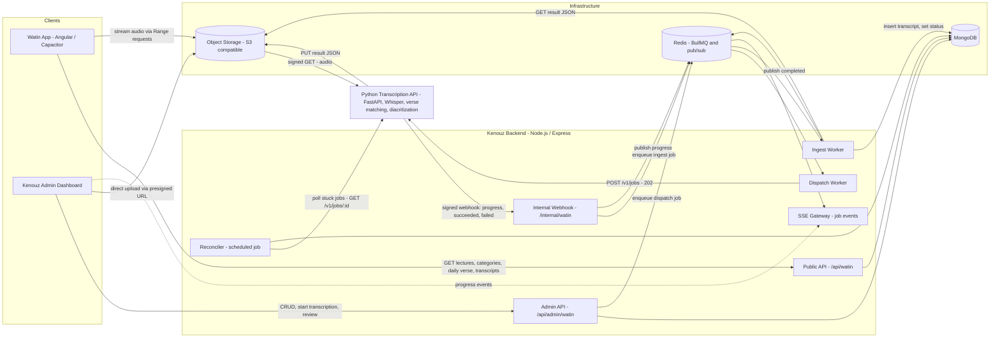
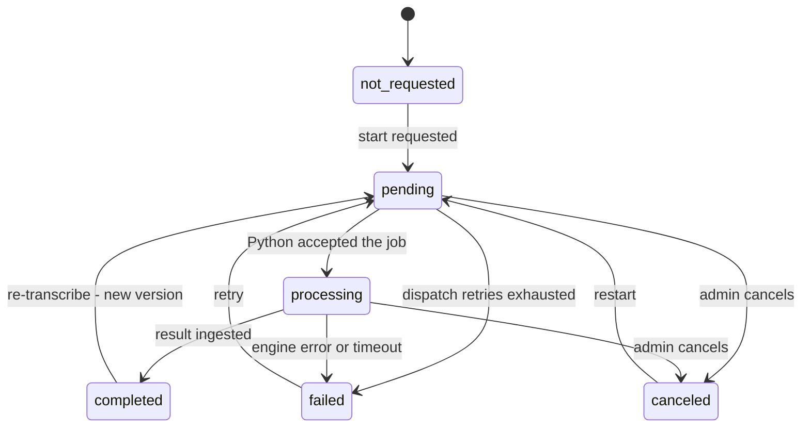
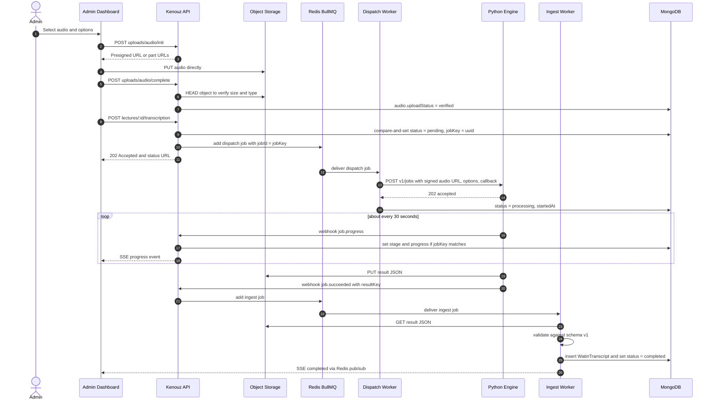

# Watin Dynamic Architecture: Master Plan

**Project:** Watin (Islamic audio transcription and learning app), part of the Kenouz ecosystem
**Version:** 1.0, 2026-10-02
**Audience:** Backend (Node.js), Frontend (Angular), and Python/ML engineers
**Status:** Proposed. Requires the confirmations listed in section 0.3 before implementation starts.

---

## 0. Document Control

### 0.1 Scope

Move Watin from a static Angular front end to a database-driven product:

1. All Watin data (categories, lectures, daily verses, transcripts) lives in MongoDB and is served by the Kenouz Node.js/Express backend.
2. Kenouz's Admin Dashboard manages Watin content (CRUD, upload, transcription, review, publish).
3. Long audio (about 1 hour or more) is transcribed asynchronously by the Python (FastAPI) engine through a queue, with status tracked on the lecture and the result persisted.
4. The Watin app (web, then Android via Capacitor) consumes public APIs and renders saved transcripts.

### 0.2 Non-goals for this iteration

- Rewriting the Python engine (only wrapping it in a job contract).
- User accounts, progress sync, notes, and bookmarks (designed as hooks in section 3.4, built later).
- Auto-detecting the recitation riwaya from audio (the riwaya is an admin input).
- Merging with the Mushaf Ward project.

### 0.3 Assumptions (developer must confirm or correct)

| # | Assumption | Impact if wrong |
|---|---|---|
| A1 | Kenouz already has JWT auth, RBAC, and a user model. | Section 7.1 (security) auth design changes. |
| A2 | Kenouz uses Mongoose over a MongoDB **replica set** (needed for transactions). | Ingest falls back to idempotent upserts (already designed, section 4.7). |
| A3 | Redis is available or can be added. | The queue layer is blocked. |
| A4 | An S3-compatible object store is available or can be added (AWS S3, Cloudflare R2, MinIO). | Without it, audio goes through Node, which is not acceptable for 1-hour files. |
| A5 | The Python engine can be **reached by Node** over HTTP (same host, VPC, or tunnel). | If it sits behind NAT, use the pull model in section 1.4. |
| A6 | Angular 17+ (standalone components, signals). | Older versions need RxJS-based stores (section 6.3 notes the alternative). |
| A7 | The Admin Dashboard is an Angular app inside Kenouz. | Section 6.7 (admin UI) adapts to the actual framework. |
| A8 | Kenouz code is TypeScript. | Strip the types from the snippets for plain JS. |

### 0.4 Guiding principles

1. **Node never does heavy work.** No audio processing, no large JSON parsing in the API process.
2. **HTTP requests never wait for transcription.** Every long operation returns `202 Accepted` plus a status resource.
3. **The database is the source of truth for status.** The queue is a delivery mechanism, not a state store.
4. **Every cross-service call is idempotent.** Retries, duplicates, and out-of-order events must be harmless.
5. **Quran text comes from a reference corpus, never from ASR or automatic diacritization.** The engine only locates verses; the displayed verse text comes from the verified corpus for the selected riwaya.
6. **Anything not verified is labelled.** Segments carry a source and a status (`auto`, `needs_review`, `confirmed`) all the way to the UI.
7. **Contract first.** One OpenAPI document, TypeScript types generated from it, and schema-validated engine output.
8. **Public clients never talk to Python.** Python is an internal service only.

---

## 1. Architecture Overview

### 1.1 System diagram



### 1.2 Components and responsibilities

| Component | Responsibility | Scaling unit |
|---|---|---|
| **Kenouz API process** (`api`) | REST, auth, validation, presigned URLs, enqueue, SSE, webhook receiver | Horizontal (stateless) |
| **Kenouz worker process** (`worker`) | BullMQ workers: `dispatch`, `ingest`, `reconcile`, `export` | Horizontal, separate from the API process |
| **Redis** | BullMQ queues, SSE fan-out via pub/sub, optional response cache | Single node with AOF, `maxmemory-policy noeviction` (BullMQ requirement) |
| **MongoDB** | Categories, speakers, lectures, transcripts, daily verses, Quran reference | Replica set |
| **Object storage** | Audio files, raw engine output JSON, exports | Managed |
| **Python engine** | Heavy transcription pipeline behind a job API | Vertical first (GPU/CPU), then more instances |

The `api` and `worker` processes share the same codebase and are started with different entry points (`node dist/server.js`, `node dist/worker.js`). This keeps the API event loop free of queue processing and large JSON ingestion.

### 1.3 Audio and payload sizing (drives several decisions)

| Item | Approximate size |
|---|---|
| 1 hour MP3 at 128 kbps | about 58 MB |
| 1 hour WAV, 16 kHz mono, 16-bit | about 115 MB |
| Transcript JSON, 1 hour, segment level | typically hundreds of KB (measure on real output) |
| Transcript JSON with word-level timestamps, 1 hour | roughly 1 MB or more (about 10k words; measure) |
| MongoDB document limit | **16 MB** (hard) |

Consequences: audio is uploaded **directly to object storage**; the transcript is stored in a **separate collection** from the lecture; word-level data is optional and size-guarded.

### 1.4 Deployment variants for the Python engine

| Variant | When | Notes |
|---|---|---|
| **Push (default)** | Python reachable from the worker (same host, VPC, or tunnel) | Dispatch worker calls `POST /v1/jobs`; Python calls back via webhook. |
| **Pull (NAT-friendly)** | Python runs on a local or GPU box that cannot accept inbound traffic | Python agent claims jobs from `POST /internal/watin/jobs/claim`, then reports with the same webhook contract. Same payloads, different transport. |

The job contract (section 5) is identical in both variants, so switching is a transport change only.

---

## 2. Database Schema Design (MongoDB / Mongoose)

### 2.1 Conventions

- Collection names are explicit and prefixed: `watin_categories`, `watin_speakers`, `watin_lectures`, `watin_transcripts`, `watin_daily_verses`, `watin_quran_verses`. The prefix prevents collisions inside the shared Kenouz database.
- `timestamps: true` everywhere.
- **Archive instead of delete** (`status: 'archived'`), with hard delete restricted to drafts without dependents.
- Admin-facing user references (`createdBy`, `updatedBy`) point to the existing Kenouz user model. The model name `User` is a placeholder.
- Public DTOs are built in a mapping layer; Mongoose documents are never returned directly.
- Arabic-first content: categories use `{ ar, en }`; lecture titles and descriptions are Arabic strings.

### 2.2 Shared helpers

```ts
// modules/watin/models/_shared.ts
import { Schema } from 'mongoose';

export const LocalizedString = new Schema(
  {
    ar: { type: String, required: true, trim: true, maxlength: 200 },
    en: { type: String, trim: true, maxlength: 200 },
  },
  { _id: false },
);

export const PublishStatus = ['draft', 'published', 'archived'] as const;

/** Arabic search normalization. Must be IDENTICAL to the Python engine's normalizer. */
export function normalizeArabic(input: string): string {
  return input
    .replace(/[\u064B-\u065F\u0670\u06D6-\u06ED\u0640]/g, '') // diacritics, dagger alef, Quranic marks, tatweel
    .replace(/[\u0622\u0623\u0625\u0671]/g, '\u0627')          // alef variants -> alef
    .replace(/\u0649/g, '\u064A')                               // alef maqsura -> ya
    .replace(/\u0629/g, '\u0647')                               // ta marbuta -> ha (matching only)
    .replace(/\s+/g, ' ')
    .trim();
}
```

> The normalization spec must be shared (one document, one test suite) between Node and Python so search and verse matching behave the same. See `quran-lecture-app-master-plan.md`, section 6.3.

### 2.3 `WatinCategory`

```ts
// modules/watin/models/WatinCategory.ts
import { Schema, model, InferSchemaType } from 'mongoose';
import { LocalizedString, PublishStatus } from './_shared';

const WatinCategorySchema = new Schema(
  {
    slug: {
      type: String, required: true, unique: true, lowercase: true, trim: true,
      match: /^[a-z0-9]+(?:-[a-z0-9]+)*$/,
    },
    name: { type: LocalizedString, required: true },
    description: { type: LocalizedString },

    // Max two levels (0 = root, 1 = child). Validated in the service layer.
    parentId: { type: Schema.Types.ObjectId, ref: 'WatinCategory', default: null },
    depth: { type: Number, enum: [0, 1], default: 0 },

    icon: {
      key: { type: String },   // design-system icon key
      url: { type: String },   // optional uploaded asset
    },
    colorToken: { type: String }, // e.g. "forest", "olive", "sand" (design token, not hex)
    sortOrder: { type: Number, default: 0 },

    status: { type: String, enum: PublishStatus, default: 'draft' },

    // Denormalized counter: PUBLISHED lectures only. Maintained by lecture publish/unpublish
    // via $inc and repaired by the nightly reconcile job.
    lectureCount: { type: Number, default: 0, min: 0 },

    createdBy: { type: Schema.Types.ObjectId, ref: 'User' },
    updatedBy: { type: Schema.Types.ObjectId, ref: 'User' },
  },
  { timestamps: true, collection: 'watin_categories' },
);

WatinCategorySchema.index({ status: 1, parentId: 1, sortOrder: 1 });

export type WatinCategoryDoc = InferSchemaType<typeof WatinCategorySchema>;
export const WatinCategory = model('WatinCategory', WatinCategorySchema);
```

**Taxonomy note:** the design currently shows two different category groupings (Home tiles vs. "App Sections"). Lectures reference categories with a many-to-many relation (`categoryIds`), so one lecture can appear under both "Qira'at" and "Tafsir". Seed data should follow one agreed list (suggested keys: `quran`, `qiraat`, `tafsir`, `fiqh`, `sharia`, `arabic`).

### 2.4 `WatinSpeaker` (recommended addition)

Needed for the "search by sheikh" experience and for admin filters. Kept deliberately small.

```ts
// modules/watin/models/WatinSpeaker.ts
const WatinSpeakerSchema = new Schema(
  {
    slug: { type: String, required: true, unique: true, lowercase: true, trim: true },
    name: { type: LocalizedString, required: true },
    title: { type: String, trim: true },        // honorific, e.g. "د."
    bio: { type: String, maxlength: 2000 },
    avatarKey: { type: String },
    status: { type: String, enum: PublishStatus, default: 'draft' },
    lectureCount: { type: Number, default: 0, min: 0 },
  },
  { timestamps: true, collection: 'watin_speakers' },
);
WatinSpeakerSchema.index({ status: 1, 'name.ar': 1 });
```

### 2.5 `WatinLecture`

The lecture holds metadata, audio reference, and **transcription state**. The heavy transcript payload lives in `WatinTranscript` (section 2.6) and is referenced by `transcription.activeTranscriptId`. This is a deliberate deviation from "embed the JSON in the lecture":

- A lecture list query would otherwise drag megabytes per row, or need careful projections everywhere.
- Re-transcription creates a **new version** without rewriting the lecture.
- Embedded growth risks the 16 MB document cap as word-level data is added.

```ts
// modules/watin/models/WatinLecture.ts
import { Schema, model, InferSchemaType } from 'mongoose';
import { PublishStatus, normalizeArabic } from './_shared';

export const TranscriptionStatus = [
  'not_requested', 'pending', 'processing', 'completed', 'failed', 'canceled',
] as const;

export const TranscriptionStage = [
  'downloading', 'preprocessing', 'transcribing',
  'matching_verses', 'diacritizing', 'finalizing', 'ingesting',
] as const;

const AudioSchema = new Schema(
  {
    storageKey: { type: String, required: true },      // e.g. watin/audio/2026/10/<lectureId>/<uuid>.mp3
    bucket: { type: String },
    originalFilename: { type: String },
    mimeType: { type: String, enum: ['audio/mpeg', 'audio/wav', 'audio/x-wav', 'audio/mp4', 'audio/x-m4a', 'audio/ogg', 'audio/flac'] },
    sizeBytes: { type: Number, min: 0 },
    durationSec: { type: Number, min: 0 },              // filled after upload verification (ffprobe in Python)
    checksumSha256: { type: String },
    uploadStatus: { type: String, enum: ['pending', 'uploaded', 'verified', 'failed'], default: 'pending' },
    uploadedAt: { type: Date },
    // `audioUrl` is NOT stored. It is derived per request: CDN URL or short-lived signed URL.
    // Optional legacy field for externally hosted audio:
    externalUrl: { type: String },
  },
  { _id: false },
);

const TranscriptionOptionsSchema = new Schema(
  {
    lectureType: { type: String, enum: ['general', 'tafsir', 'tadabbur', 'tajweed'], default: 'general' },
    riwayaCodes: { type: [String], default: [] },       // e.g. ['hafs']; validated against the riwaya registry
    detectVerses: { type: Boolean, default: true },
    mergeRepeats: { type: Boolean, default: false },    // tajweed lessons: collapse repeated recitations
    diacritize: { type: String, enum: ['off', 'auto', 'auto_no_case_ending'], default: 'off' },
    language: { type: String, default: 'ar' },
    dialectHint: { type: String, enum: ['msa', 'egyptian', 'mixed'], default: 'mixed' },
    wordTimestamps: { type: Boolean, default: false },
  },
  { _id: false },
);

const TranscriptionSchema = new Schema(
  {
    status: { type: String, enum: TranscriptionStatus, default: 'not_requested' },
    stage: { type: String, enum: TranscriptionStage },
    progress: { type: Number, min: 0, max: 100, default: 0 },

    jobKey: { type: String },                           // UUID per request; idempotency key end to end
    attempt: { type: Number, default: 0 },
    options: { type: TranscriptionOptionsSchema, default: () => ({}) },

    requestedBy: { type: Schema.Types.ObjectId, ref: 'User' },
    requestedAt: { type: Date },
    startedAt: { type: Date },
    completedAt: { type: Date },
    lastHeartbeatAt: { type: Date },

    engine: {
      name: String, version: String, asrModel: String, diacritizer: String,
    },

    error: {
      code: String,         // AUDIO_UNREADABLE | AUDIO_TOO_LONG | ASR_FAILED | OOM | TIMEOUT | ENGINE_UNREACHABLE | INGEST_INVALID
      message: String,
      retryable: Boolean,
      at: Date,
    },

    activeTranscriptId: { type: Schema.Types.ObjectId, ref: 'WatinTranscript' },
    reviewStatus: { type: String, enum: ['unreviewed', 'in_review', 'reviewed'], default: 'unreviewed' },

    summary: {
      segmentCount: Number,
      wordCount: Number,
      verseMatchCount: Number,
      needsReviewCount: Number,
    },
  },
  { _id: false },
);

const WatinLectureSchema = new Schema(
  {
    slug: { type: String, required: true, unique: true, lowercase: true, trim: true },
    title: { type: String, required: true, trim: true, maxlength: 250 },
    description: { type: String, maxlength: 5000 },

    speakerId: { type: Schema.Types.ObjectId, ref: 'WatinSpeaker', index: true },
    categoryIds: {
      type: [{ type: Schema.Types.ObjectId, ref: 'WatinCategory' }],
      validate: (v: unknown[]) => v.length >= 1 && v.length <= 5,
    },
    primaryCategoryId: { type: Schema.Types.ObjectId, ref: 'WatinCategory' },
    tags: { type: [String], default: [] },
    series: { name: String, order: Number },
    recordedAt: { type: Date },

    audio: { type: AudioSchema },
    coverKey: { type: String },

    transcription: { type: TranscriptionSchema, default: () => ({}) },

    // Publishing is independent of transcription status
    status: { type: String, enum: PublishStatus, default: 'draft' },
    publishedAt: { type: Date },
    scheduledAt: { type: Date },
    transcriptPublic: { type: Boolean, default: false }, // expose transcript to the public app

    // Arabic-normalized search field, computed in a pre-save hook
    searchText: { type: String, select: false },

    stats: { plays: { type: Number, default: 0 } },

    createdBy: { type: Schema.Types.ObjectId, ref: 'User' },
    updatedBy: { type: Schema.Types.ObjectId, ref: 'User' },
  },
  { timestamps: true, collection: 'watin_lectures' },
);

WatinLectureSchema.pre('save', function (next) {
  this.searchText = normalizeArabic([this.title, this.description ?? '', ...(this.tags ?? [])].join(' '));
  next();
});

// Public listing (cursor pagination: publishedAt desc, _id desc)
WatinLectureSchema.index({ status: 1, publishedAt: -1, _id: -1 });
WatinLectureSchema.index({ categoryIds: 1, status: 1, publishedAt: -1, _id: -1 });
WatinLectureSchema.index({ speakerId: 1, status: 1, publishedAt: -1 });
// Admin filters and reconciler
WatinLectureSchema.index({ 'transcription.status': 1, 'transcription.lastHeartbeatAt': 1 });
// Arabic search: simple tokenization on the normalized field (no stemming).
// If Kenouz runs on Atlas, prefer Atlas Search with an Arabic analyzer (evaluate quality on real queries).
WatinLectureSchema.index({ searchText: 'text' }, { default_language: 'none' });

export type WatinLectureDoc = InferSchemaType<typeof WatinLectureSchema>;
export const WatinLecture = model('WatinLecture', WatinLectureSchema);
```

**Business rule:** a lecture can be `published` without a transcript, and a transcript can exist while `transcriptPublic` is false (review first). The public app only receives a transcript when `status = published AND transcription.status = completed AND transcriptPublic = true`.

### 2.6 `WatinTranscript` (the transcription JSON)

```ts
// modules/watin/models/WatinTranscript.ts
const VerseMatchSchema = new Schema(
  {
    surah: { type: Number, min: 1, max: 114, required: true },
    ayahFrom: { type: Number, min: 1, required: true },
    ayahTo: { type: Number, min: 1, required: true },
    wordFrom: { type: Number },               // partial-verse support (tajweed lessons)
    wordTo: { type: Number },
    riwayaCode: { type: String, required: true },
    referenceText: { type: String, required: true }, // snapshot from the verified corpus (never ASR text)
    score: { type: Number, min: 0, max: 1 },
    matchType: { type: String, enum: ['exact', 'normalized', 'partial', 'fuzzy'] },
    status: { type: String, enum: ['auto', 'needs_review', 'confirmed', 'corrected', 'rejected'], default: 'auto' },
  },
  { _id: true },
);

const SegmentSchema = new Schema(
  {
    idx: { type: Number, required: true },
    startSec: { type: Number, required: true, min: 0 },
    endSec: { type: Number, required: true, min: 0 },
    kind: { type: String, enum: ['speech', 'recitation', 'mixed'], default: 'speech' },

    rawText: { type: String, required: true },   // immutable engine output
    text: { type: String, required: true },      // display text (may be diacritized or edited)
    diacritization: {
      mode: { type: String, enum: ['none', 'reference', 'auto', 'manual'], default: 'none' },
      tool: { type: String },                    // e.g. "mishkal@x.y"
    },
    confidence: { type: Number, min: 0, max: 1 },
    verseMatches: { type: [VerseMatchSchema], default: [] },

    edited: { type: Boolean, default: false },
    editedBy: { type: Schema.Types.ObjectId, ref: 'User' },
    editedAt: { type: Date },

    words: { type: [{ w: String, s: Number, e: Number }], select: false }, // optional, size-guarded
  },
  { _id: false },
);

const WatinTranscriptSchema = new Schema(
  {
    lectureId: { type: Schema.Types.ObjectId, ref: 'WatinLecture', required: true },
    version: { type: Number, required: true },                // 1, 2, 3 ... per lecture
    jobKey: { type: String, required: true },                 // ties the doc to one engine run (idempotent ingest)
    schemaVersion: { type: String, required: true },          // engine output schema, e.g. "1.0"
    state: { type: String, enum: ['active', 'superseded'], default: 'active' },

    language: { type: String, default: 'ar' },
    options: { type: Schema.Types.Mixed },                    // options used for this run (audit)
    engine: { name: String, version: String, asrModel: String, diacritizer: String },

    segments: { type: [SegmentSchema], default: [] },
    chapters: { type: [{ title: String, startSec: Number }], default: [] },

    rawOutputKey: { type: String },                           // immutable engine JSON in object storage

    stats: { segmentCount: Number, wordCount: Number, verseMatchCount: Number, needsReviewCount: Number },
  },
  { timestamps: true, collection: 'watin_transcripts' },
);

WatinTranscriptSchema.index({ lectureId: 1, version: -1 }, { unique: true });
WatinTranscriptSchema.index({ lectureId: 1, jobKey: 1 }, { unique: true }); // makes ingest idempotent

// Size guard before insert: reject or offload `words` to object storage if close to the BSON cap.
// import { calculateObjectSize } from 'bson'; throw if > ~12 MB.

export const WatinTranscript = model('WatinTranscript', WatinTranscriptSchema);
```

**Rules:**

- `rawText` and `rawOutputKey` are never modified, so you can re-derive anything.
- An edit changes `text`, sets `edited`, and records who and when.
- Verse segments: `text` is built from `referenceText` for the selected riwaya. Diacritization mode is `reference`.
- Automatic diacritization (`mode = auto`) applies **only to non-Quran segments**, and the UI and exports label it "automatic".
- Segment-level search is deferred. If needed later, project segments into a `watin_transcript_segments` collection with `normalizedText` and a text index.

### 2.7 `WatinDailyVerse`

```ts
// modules/watin/models/WatinDailyVerse.ts
const WatinDailyVerseSchema = new Schema(
  {
    // Calendar day in the configured timezone (default Africa/Cairo). Omitted for evergreen pool entries.
    date: { type: String, match: /^\d{4}-\d{2}-\d{2}$/ },
    timezone: { type: String, default: 'Africa/Cairo' },

    surah: { type: Number, min: 1, max: 114, required: true },
    ayahFrom: { type: Number, min: 1, required: true },
    ayahTo: { type: Number, min: 1, required: true },
    riwayaCode: { type: String, default: 'hafs' },

    // Filled by the SERVER from watin_quran_verses. Admins pick surah and ayah, never type the verse.
    textSnapshot: { type: String, required: true },
    textSource: { name: String, version: String },

    reflection: { type: String, maxlength: 1000 },      // short tadabbur note (admin-authored)
    reflectionSource: { type: String },
    imageKey: { type: String },                          // background image

    status: { type: String, enum: ['draft', 'scheduled', 'published', 'archived'], default: 'draft' },
    isEvergreen: { type: Boolean, default: false },      // eligible for the fallback pool

    createdBy: { type: Schema.Types.ObjectId, ref: 'User' },
    updatedBy: { type: Schema.Types.ObjectId, ref: 'User' },
  },
  { timestamps: true, collection: 'watin_daily_verses' },
);

WatinDailyVerseSchema.index({ date: 1 }, { unique: true, sparse: true });
WatinDailyVerseSchema.index({ isEvergreen: 1, status: 1 });
```

**Selection logic (`GET /watin/daily-verse`):**

1. Compute today's date in the configured timezone.
2. If a `published` document exists for that date, return it with `source: "scheduled"`.
3. Otherwise pick deterministically from the evergreen pool: `pool[hash(date) % pool.length]`, return it with `source: "fallback"`. The endpoint never returns an empty home screen.

### 2.8 `WatinQuranVerse` (read-only reference corpus)

```ts
const WatinQuranVerseSchema = new Schema(
  {
    riwayaCode: { type: String, required: true },
    surah: { type: Number, required: true, min: 1, max: 114 },
    ayah: { type: Number, required: true, min: 1 },
    text: { type: String, required: true },            // diacritized, from the verified source
    normalizedText: { type: String, required: true },  // for matching
    source: { name: String, version: String, license: String },
    reviewStatus: { type: String, enum: ['verified', 'experimental'], default: 'experimental' },
  },
  { collection: 'watin_quran_verses' },
);
WatinQuranVerseSchema.index({ riwayaCode: 1, surah: 1, ayah: 1 }, { unique: true });
```

- Seeded by a versioned import script (Tanzil for Hafs first; other riwayat stay `experimental` until reviewed by a qualified person).
- **One corpus version for both systems:** the Python engine loads the same versioned export, so Node and Python agree on every verse.
- Used for: daily verse snapshots, admin verse picker and preview, and validation of `verseMatches`.

### 2.9 Migration of static content

A one-time seed script converts the hardcoded Angular lists (categories, lectures) into documents. The fake statuses in the current lectures list are **not** migrated; real statuses derive from `transcription.status` and `status`.

---

## 3. Backend API

### 3.1 Conventions

- **Base paths:** public `/api/watin/v1`, admin `/api/admin/watin/v1`, internal `/internal/watin/v1`.
- **Envelope:** `{ "data": ..., "meta": { ... } }`. Errors use RFC 9457 (`application/problem+json`) with a stable `code`.
- **Pagination:** cursor-based (`?limit=20&cursor=<opaque>`), response `meta: { nextCursor, hasMore }`. Offset pagination is allowed only in admin tables, capped.
- **Validation:** schema validation (zod or Joi) on every route; unknown fields rejected.
- **Contract:** OpenAPI 3.1 generated from the validators; Angular types generated from it (section 6.1).
- **Auth:** Admin = Kenouz JWT + permission `watin:manage` (editor role: `watin:edit`, reviewer role: `watin:review`). Public = anonymous reads with rate limiting (user-bound features added later).
- **Idempotency:** `Idempotency-Key` header supported on `POST /transcription` and `POST /lectures`.

### 3.2 Admin API (Kenouz Dashboard)

| Method | Path | Purpose | Notes |
|---|---|---|---|
| **Categories** | | | |
| GET | `/categories` | List (filters: `status`, `parentId`, `q`) | |
| POST | `/categories` | Create | Slug uniqueness; max depth 2 |
| GET | `/categories/:id` | Detail | |
| PATCH | `/categories/:id` | Update | |
| DELETE | `/categories/:id` | Archive | `409` if published lectures reference it, unless `?reassignTo=<id>` |
| POST | `/categories/reorder` | Bulk `sortOrder` | Body `[{id, sortOrder}]` |
| **Speakers** | | | |
| GET / POST | `/speakers` | List / create | |
| GET / PATCH / DELETE | `/speakers/:id` | Detail / update / archive | |
| **Lectures** | | | |
| GET | `/lectures` | Table (filters: `status`, `transcriptionStatus`, `categoryId`, `speakerId`, `q`) | Offset pagination allowed |
| POST | `/lectures` | Create draft (metadata only) | Returns `id` for the upload step |
| GET | `/lectures/:id` | Full detail incl. transcription meta | |
| PATCH | `/lectures/:id` | Update metadata | |
| DELETE | `/lectures/:id` | Archive; hard delete only for drafts | Hard delete also removes audio and transcripts (async cleanup job) |
| POST | `/lectures/:id/publish` | Publish | Updates category/speaker counters atomically |
| POST | `/lectures/:id/unpublish` | Unpublish | |
| **Audio upload (direct to object storage)** | | | |
| POST | `/uploads/audio/init` | Body `{lectureId, filename, mimeType, sizeBytes}` returns `{uploadId, storageKey, mode, urls[]}` | `mode: single` (presigned PUT) or `multipart` (per-part URLs). Enforces size and MIME limits. |
| POST | `/uploads/audio/complete` | Body `{uploadId, parts?[{partNumber, etag}]}` | API issues `HEAD` on the object, verifies size, sets `audio.uploadStatus = verified` |
| POST | `/uploads/audio/abort` | Abort and clean up | |
| **Transcription** | | | |
| POST | `/lectures/:id/transcription` | Start. Body: `options` (section 2.5). **Returns `202`** | `409` if already `pending` or `processing`; requires verified audio |
| GET | `/lectures/:id/transcription` | Current status, stage, progress, error | Polling fallback |
| GET | `/lectures/:id/transcription/events` | **SSE** stream of progress | See section 4.8 |
| POST | `/lectures/:id/transcription/cancel` | Cancel | Moves to `canceled`, signals Python |
| POST | `/lectures/:id/transcription/retry` | Retry after `failed` | New `jobKey` |
| GET | `/transcription-jobs` | Cross-lecture job list for ops | Filter by status and date |
| **Transcript review** | | | |
| GET | `/lectures/:id/transcript` | Active transcript (segments, matches) | `?version=` for older versions |
| GET | `/lectures/:id/transcript/versions` | Version history | |
| POST | `/lectures/:id/transcript/versions/:v/activate` | Roll back or forward | |
| PATCH | `/lectures/:id/transcript/segments/:idx` | Edit `text`, `kind` | Sets `edited` fields |
| POST | `/lectures/:id/transcript/segments/:idx/verse-matches/:matchId/confirm` | Confirm match | `status = confirmed` |
| POST | `/lectures/:id/transcript/segments/:idx/verse-matches/:matchId/reject` | Reject match | |
| PUT | `/lectures/:id/transcript/segments/:idx/verse-matches/:matchId` | Replace with another ayah | Server re-fills `referenceText` from corpus; `status = corrected` |
| PATCH | `/lectures/:id/transcript/review` | Body `{reviewStatus, transcriptPublic}` | |
| **Daily verses** | | | |
| GET | `/daily-verses` | List; `?month=2026-10` for calendar | |
| POST | `/daily-verses` | Create (surah, ayah range, optional date) | Server fills `textSnapshot` |
| PATCH / DELETE | `/daily-verses/:id` | Update / archive | |
| POST | `/daily-verses/bulk-schedule` | Schedule many by date | |
| GET | `/quran/verses/preview` | `?surah=&ayah=&riwaya=` | Preview from corpus |
| **Ops** | | | |
| GET | `/admin/queues` (outside the versioned path) | Bull Board UI | Behind admin auth, ops role only |

### 3.3 Public API (Watin app)

| Method | Path | Purpose | Cache |
|---|---|---|---|
| GET | `/home` | One call for the home screen: daily verse, latest lectures (limit), featured categories | `max-age=60, stale-while-revalidate=300` |
| GET | `/categories` | Published tree with counts | `max-age=300, stale-while-revalidate=3600` |
| GET | `/categories/:slug` | Category detail | same |
| GET | `/speakers` | Published speakers (optional) | same |
| GET | `/lectures` | List. Filters: `category`, `speaker`, `q`, `hasTranscript`. Cursor pagination | `max-age=60` |
| GET | `/lectures/:slug` | Lecture detail with a signed or CDN `audioUrl` and transcript availability | `no-cache` (signed URL), ETag on metadata |
| GET | `/lectures/:id/transcript` | Segments for the active version (only if public) | `ETag` strong, `Cache-Control: public, max-age=31536000, immutable` when requested as `?v=<version>` |
| GET | `/daily-verse` | Today's verse (`?date=` for history) | Cache until local midnight |
| GET | `/search` | `q` over lectures (and later transcripts); `type=lectures` | `max-age=30` |

**Public lecture list item (DTO):**

```json
{
  "id": "…", "slug": "sharh-shatibiyya-01", "title": "شرح منظومة الشاطبية",
  "speaker": { "id": "…", "name": "…" },
  "categories": [{ "id": "…", "slug": "qiraat", "name": "القراءات" }],
  "durationSec": 2720, "publishedAt": "2026-10-01T09:00:00Z", "coverUrl": null,
  "hasTranscript": true, "transcriptReviewed": false
}
```

The UI badges ("transcribed", "needs review") derive from `hasTranscript` and `transcriptReviewed`, which replaces the hardcoded fake statuses.

### 3.4 Reserved for the next iteration (account-bound)

| Method | Path | Purpose |
|---|---|---|
| PUT | `/me/progress/:lectureId` | Playback position (powers "continue your journey") |
| GET/POST | `/me/notes` | Timestamped notes |
| GET/POST/DELETE | `/me/library` | Saved items |
| POST | `/lectures/:id/exports` | PDF/TXT export job (same queue pattern, `export` queue) |

### 3.5 Internal API (service to service)

| Method | Path | Caller | Purpose |
|---|---|---|---|
| POST | `/internal/watin/v1/transcription/events` | Python | Signed webhook (section 4.5) |
| POST | `/internal/watin/v1/jobs/claim` | Python agent (pull variant only) | Claim the next job |

---

## 4. Asynchronous Transcription Workflow

### 4.1 Design summary

| Concern | Decision |
|---|---|
| Upload of long audio | Browser uploads **directly to object storage** via presigned URL (multipart for large files). Node never proxies audio. |
| Triggering work | `POST /transcription` validates, writes `pending` to MongoDB, enqueues a **dispatch** job in BullMQ, returns `202`. |
| Calling Python | A short-lived **dispatch** job submits to `POST /v1/jobs` and returns. It does not wait for the transcription. |
| Progress and completion | Python sends **signed webhooks**. Node validates, updates MongoDB, and republishes to the admin UI via SSE. |
| Result transport | Python uploads the result JSON to object storage and sends a **pointer**. An **ingest** job fetches, validates, and writes it. |
| Lost events | A scheduled **reconciler** polls Python for jobs that went quiet. |
| Source of truth | MongoDB (`transcription.*` on the lecture). Redis only delivers. |

**Why two short jobs instead of one job that waits for an hour:** a worker holding a BullMQ job for the whole transcription occupies a concurrency slot and lock renewal for an hour, and a worker restart in the middle creates stalled-job complexity. The dispatch/webhook/ingest split keeps every queue job short and restart-safe. A simpler alternative for a first iteration is a single worker job that polls `GET /v1/jobs/:id` until done (concurrency 1); the contract below supports both.

### 4.2 Status model



`stage` and `progress` are only meaningful while `processing`:

| Stage | Weight (suggested) |
|---|---|
| downloading | 0 to 5 % |
| preprocessing (ffmpeg, VAD, chunking) | 5 to 10 % |
| transcribing | 10 to 75 % (by chunk) |
| matching_verses | 75 to 85 % |
| diacritizing | 85 to 95 % |
| finalizing (upload result) | 95 to 99 % |
| ingesting (Node side) | 99 to 100 % |

### 4.3 End-to-end sequence



### 4.4 Queues and job options

| Queue | Producer | Consumer | Concurrency | Retry policy |
|---|---|---|---|---|
| `watin-dispatch` | API (start / retry) | Dispatch worker | Sized to Python capacity (see 4.6) | 5 attempts, exponential backoff starting at 30 s, for network errors, 5xx, and 429 |
| `watin-ingest` | Webhook handler | Ingest worker | 2 | 3 attempts, exponential backoff |
| `watin-reconcile` | Scheduler (every 60 s) | Reconciler | 1 | none (runs again next tick) |
| `watin-export` (later) | API | Export worker | 1 to 2 | 2 attempts |

```ts
// infra/queues.ts
import { Queue } from 'bullmq';
import IORedis from 'ioredis';

export const connection = new IORedis(process.env.REDIS_URL!, { maxRetriesPerRequest: null }); // required by workers

export const dispatchQueue = new Queue('watin-dispatch', {
  connection,
  defaultJobOptions: {
    attempts: 5,
    backoff: { type: 'exponential', delay: 30_000 },
    removeOnComplete: { age: 24 * 3600, count: 1000 },
    removeOnFail: { age: 7 * 24 * 3600 },
  },
});
```

```ts
// api: start transcription (inside the route handler / service)
const jobKey = crypto.randomUUID();

const updated = await WatinLecture.findOneAndUpdate(
  {
    _id: lectureId,
    'audio.uploadStatus': 'verified',
    'transcription.status': { $in: ['not_requested', 'completed', 'failed', 'canceled'] }, // not already running
  },
  {
    $set: {
      'transcription.status': 'pending',
      'transcription.jobKey': jobKey,
      'transcription.options': options,
      'transcription.requestedBy': adminId,
      'transcription.requestedAt': new Date(),
      'transcription.progress': 0,
      'transcription.error': null,
    },
    $inc: { 'transcription.attempt': 1 },
  },
  { new: true },
);
if (!updated) throw conflict('TRANSCRIPTION_NOT_STARTABLE');

await dispatchQueue.add('dispatch', { lectureId, jobKey }, { jobId: jobKey }); // jobId makes enqueue idempotent
return res.status(202).json({ data: { jobKey, statusUrl: `/lectures/${lectureId}/transcription` } });
```

> The compare-and-set on `transcription.status` prevents two admins from starting the same lecture twice. A BullMQ `jobId` equal to `jobKey` prevents duplicate enqueues. Verify option names against your installed BullMQ version.

### 4.4.1 Dispatch worker

```ts
// worker/dispatch.worker.ts
import { Worker, UnrecoverableError } from 'bullmq';

new Worker('watin-dispatch', async (job) => {
  const { lectureId, jobKey } = job.data;
  const lecture = await WatinLecture.findById(lectureId).lean();

  // Stale job guard: the lecture moved on (canceled, or a newer jobKey exists)
  if (!lecture || lecture.transcription?.jobKey !== jobKey || lecture.transcription.status !== 'pending') return;

  const res = await python.createJob({
    jobId: jobKey,
    lectureId,
    audio: { url: await storage.signedGet(lecture.audio!.storageKey, 6 * 3600) },
    options: lecture.transcription.options,
    callback: { url: `${process.env.INTERNAL_BASE_URL}/internal/watin/v1/transcription/events` },
    output: await storage.signedPutForResult(lectureId, jobKey),
    schemaVersion: '1.0',
  });

  if (res.status === 429) throw new RetryLater(res.retryAfterMs);                // pseudo-code: manual rate limit, see 4.6 (delay without burning attempts)
  if (res.status >= 400 && res.status < 500 && res.status !== 409) throw new UnrecoverableError(`ENGINE_REJECTED:${res.status}`);
  // 202 (accepted) and 409 (already exists, idempotent) are both success

  await WatinLecture.updateOne(
    { _id: lectureId, 'transcription.jobKey': jobKey, 'transcription.status': 'pending' },
    { $set: { 'transcription.status': 'processing', 'transcription.startedAt': new Date(), 'transcription.lastHeartbeatAt': new Date() } },
  );
}, { connection, concurrency: Number(process.env.PY_MAX_CONCURRENCY ?? 1) });
```

On final failure (all attempts exhausted), a `failed` listener sets `transcription.status = 'failed'` with `error.code = ENGINE_UNREACHABLE` and `retryable = true`.

### 4.5 Webhook (Python to Kenouz): security and handling

**Request headers**

```
X-Watin-Event-Id:   <uuid>        # idempotency
X-Watin-Timestamp:  <unix seconds>
X-Watin-Signature:  v1=<hex hmac-sha256( timestamp + "." + rawBody )>
Content-Type: application/json
```

```ts
// api: internal webhook route. Needs the RAW body, so mount BEFORE express.json() for this path.
app.post('/internal/watin/v1/transcription/events',
  express.raw({ type: 'application/json', limit: '256kb' }),
  async (req, res) => {
    const ts = Number(req.header('X-Watin-Timestamp'));
    if (!Number.isFinite(ts) || Math.abs(Date.now() / 1000 - ts) > 300) return res.sendStatus(401); // replay window

    const expected = crypto.createHmac('sha256', process.env.WATIN_WEBHOOK_SECRET!)
      .update(`${ts}.`).update(req.body).digest('hex');
    const given = (req.header('X-Watin-Signature') ?? '').replace(/^v1=/, '');
    const ok = given.length === expected.length &&
      crypto.timingSafeEqual(Buffer.from(given), Buffer.from(expected));
    if (!ok) return res.sendStatus(401);

    const event = JSON.parse(req.body.toString('utf8'));
    await handleEvent(event);        // idempotent, see below
    res.sendStatus(204);             // ack fast; no heavy work in this handler
  });
```

**`handleEvent` rules (all updates are conditional on `jobKey`):**

| Event | Action |
|---|---|
| `job.progress` | `updateOne({_id, 'transcription.jobKey': jobId, 'transcription.status': 'processing'}, { $set: {stage, lastHeartbeatAt}, $max: {'transcription.progress': progress} })`; publish to Redis channel `watin:lecture:<id>:events`. `$max` keeps progress monotonic even when events arrive out of order. |
| `job.succeeded` | Enqueue `watin-ingest` with `{lectureId, jobKey, resultKey, sha256}` using `jobId = jobKey + ':ingest'`. Does not touch status; ingest does. |
| `job.failed` | Set `failed` with `error.{code, message, retryable}` if `jobKey` matches and status is `pending` or `processing`. |
| `job.canceled` | Set `canceled` if matching. |
| Duplicate `eventId` | Ignored (store processed ids in Redis with a 24 h TTL, or rely on the conditional updates above). |
| Unknown `jobKey` (stale run) | Ignored with `200/204`. Never fail loudly on stale events. |

### 4.6 Capacity control (Python is the bottleneck)

- Python advertises its slot count (`PY_MAX_CONCURRENCY`, default 1 for a single GPU/CPU box). Dispatch concurrency matches it.
- When Python is full it answers `429` with `Retry-After`. The dispatch worker uses BullMQ's manual rate limit (`worker.rateLimit(ms)` followed by throwing `Worker.RateLimitError()`, verify against your BullMQ version) so the job is **delayed without consuming a retry attempt**.
- Admin UI shows `pending` with queue position when available (`position` in the `202` response of `POST /v1/jobs`, or derived from BullMQ).

### 4.7 Ingest worker

```ts
// worker/ingest.worker.ts
new Worker('watin-ingest', async (job) => {
  const { lectureId, jobKey, resultKey, sha256 } = job.data;

  const lecture = await WatinLecture.findById(lectureId).lean();
  if (!lecture || lecture.transcription?.jobKey !== jobKey) return;               // stale run
  if (lecture.transcription.status === 'completed') return;                       // already ingested (idempotent)

  const bytes = await storage.getObject(resultKey);                               // stream into memory in the WORKER process
  if (sha256 && sha256Of(bytes) !== sha256) throw new Error('CHECKSUM_MISMATCH');

  const result = JSON.parse(bytes.toString('utf8'));
  const parsed = TranscriptResultV1.parse(result);                                // zod/ajv schema validation
  await verifyVerseMatchesAgainstCorpus(parsed);                                  // referenceText must equal corpus text

  const version = (await WatinTranscript.countDocuments({ lectureId })) + 1;
  const session = await mongoose.startSession();                                  // if replica set; else use the upsert fallback below
  await session.withTransaction(async () => {
    await WatinTranscript.updateMany({ lectureId, state: 'active' }, { $set: { state: 'superseded' } }, { session });
    const [doc] = await WatinTranscript.create([{ lectureId, version, jobKey, ...toTranscriptDoc(parsed), rawOutputKey: resultKey }], { session });
    await WatinLecture.updateOne(
      { _id: lectureId, 'transcription.jobKey': jobKey },
      { $set: {
          'transcription.status': 'completed', 'transcription.progress': 100,
          'transcription.completedAt': new Date(), 'transcription.activeTranscriptId': doc._id,
          'transcription.reviewStatus': 'unreviewed', 'transcription.summary': summarize(parsed),
          'transcription.engine': parsed.engine, 'audio.durationSec': parsed.audio.durationSec,
        },
        $unset: { 'transcription.stage': '' },
      },
      { session },
    );
  });
  await redis.publish(`watin:lecture:${lectureId}:events`, JSON.stringify({ type: 'completed' }));
}, { connection, concurrency: 2 });
```

**Idempotency without transactions (fallback):** the unique index `{lectureId, jobKey}` on `watin_transcripts` makes a repeated insert fail harmlessly; the worker catches the duplicate-key error, then performs the lecture update (itself conditional on `jobKey`). A crash between the two writes is repaired by the reconciler (it finds a transcript for the `jobKey` while the lecture still says `processing`).

**Validation failure:** schema-invalid results set `failed` with `INGEST_INVALID` and `retryable = false`. The raw file stays in storage for debugging.

### 4.8 Real-time updates to the Admin UI (SSE)

```ts
// api: GET /lectures/:id/transcription/events
router.get('/lectures/:id/transcription/events', requirePermission('watin:manage'), async (req, res) => {
  res.set({ 'Content-Type': 'text/event-stream', 'Cache-Control': 'no-cache, no-transform', Connection: 'keep-alive', 'X-Accel-Buffering': 'no' });
  res.flushHeaders();

  const snapshot = await getTranscriptionStatus(req.params.id);
  res.write(`event: status\ndata: ${JSON.stringify(snapshot)}\n\n`);                // immediate state on connect

  const sub = redis.duplicate();
  await sub.subscribe(`watin:lecture:${req.params.id}:events`);
  sub.on('message', (_c, msg) => res.write(`event: update\ndata: ${msg}\n\n`));

  const hb = setInterval(() => res.write(': ping\n\n'), 25_000);                    // keeps proxies from closing the stream
  req.on('close', () => { clearInterval(hb); sub.quit(); });
});
```

- Browser `EventSource` cannot send an `Authorization` header. Use cookie-based auth, or issue a short-lived one-time ticket (`POST .../events-ticket` returns `?ticket=`), or use a fetch-based SSE client.
- Disable proxy buffering for this route (for nginx: `proxy_buffering off`).
- **Fallback:** the UI polls `GET /transcription` every 5 s (backing off to 15 s) if SSE is unavailable. The status endpoint is the contract; SSE is an optimization.

### 4.9 Reconciler (self-healing)

Runs every 60 s as a scheduled BullMQ job (Job Schedulers in BullMQ 5.16+, or the `repeat` option on older versions):

1. Find lectures with `transcription.status = 'processing'` and `lastHeartbeatAt` older than `HEARTBEAT_TIMEOUT` (default 5 min).
2. For each, call `GET /v1/jobs/:jobKey` on Python:
   - `succeeded` and the transcript is not yet ingested: enqueue ingest (lost webhook).
   - `running`: refresh `lastHeartbeatAt`, apply the reported progress.
   - `failed` or `canceled`: apply it.
   - `404` or unreachable for more than N consecutive ticks: mark `failed` (`ENGINE_UNREACHABLE`, retryable).
3. Enforce a **hard runtime cap**: `startedAt + max(30 min, durationSec × MAX_RTF)`; beyond it, cancel on Python and mark `failed` (`TIMEOUT`). `MAX_RTF` is set after measuring real throughput (it is currently unknown).
4. Find `pending` lectures older than 10 minutes with no queue job (Redis loss) and re-enqueue.
5. Nightly (separate schedule): recompute `lectureCount` on categories and speakers.

### 4.10 Cancel, retry, re-transcribe

- **Cancel:** conditional set to `canceled`, then `DELETE /v1/jobs/:jobKey` on Python (best effort). Python checks a cancel flag between chunks.
- **Retry:** new `jobKey`, same options; `attempt` increments.
- **Re-transcribe (completed lecture):** creates a new transcript **version**. The current active version stays live until the new one is ingested and activated, so the public app never sees a gap. Manual edits on the old version are not copied automatically (surface this in the UI).

### 4.11 Why the Node event loop and HTTP requests stay safe

| Risk | Mitigation |
|---|---|
| Large upload blocks API | Direct-to-storage upload; the API only signs URLs and verifies. |
| Request waits for transcription | `202` plus a status resource; no request waits on the engine. |
| Big JSON parse in API process | Result is size-checked and then parsed in the **worker** process; webhook payloads are small (pointers only, 256 KB cap). |
| Long job holds a worker for an hour | Dispatch and ingest jobs are short; long work lives in Python. |
| Lost webhook | Reconciler polling plus idempotent ingest. |
| Duplicate or out-of-order events | `jobKey`-conditional updates, `$max` progress, unique `{lectureId, jobKey}` index. |
| Python overload | 429 with `Retry-After`, concurrency matched to Python capacity. |
| Redis restart | AOF persistence; MongoDB is the truth, and the reconciler re-enqueues orphaned `pending` work. |

---

## 5. Python Transcription API Contract (v1)

This section defines what the existing FastAPI engine must expose. Today Angular calls Python directly and receives the JSON in the response; that call is **removed** and replaced by this job API (Python is no longer public).

### 5.1 Endpoints

| Method | Path | Behavior |
|---|---|---|
| POST | `/v1/jobs` | Accept a job. `202` accepted, `409` same `jobId` already exists (return its state), `422` invalid, `429` busy (+ `Retry-After`) |
| GET | `/v1/jobs/{jobId}` | `{state, stage, progress, startedAt, updatedAt, resultKey?, error?}`; `state` in `queued, running, succeeded, failed, canceled` |
| DELETE | `/v1/jobs/{jobId}` | Request cancel (idempotent) |
| GET | `/v1/health` | Liveness, slot count, model versions |

**Service authentication:** internal network only, plus a static service token (`Authorization: Bearer`) or mTLS. Not exposed to the internet or to browsers (CORS closed).

### 5.2 Create-job request

```json
{
  "jobId": "5b1f3b0e-…",
  "lectureId": "665f…",
  "schemaVersion": "1.0",
  "audio": { "url": "https://storage…/signed-get", "durationHintSec": 3600 },
  "options": {
    "lectureType": "tajweed",
    "riwayaCodes": ["hafs"],
    "detectVerses": true,
    "mergeRepeats": true,
    "diacritize": "auto_no_case_ending",
    "language": "ar",
    "dialectHint": "egyptian",
    "wordTimestamps": false
  },
  "callback": { "url": "https://kenouz.internal/internal/watin/v1/transcription/events" },
  "output": { "key": "watin/transcripts/665f…/5b1f3b0e.json", "putUrl": "https://storage…/signed-put" }
}
```

### 5.3 Webhook events

```json
{ "eventId": "…", "type": "job.progress", "jobId": "…", "occurredAt": "2026-10-02T10:00:00Z",
  "data": { "stage": "transcribing", "progress": 42, "chunk": { "done": 14, "total": 33 } } }

{ "eventId": "…", "type": "job.succeeded", "jobId": "…",
  "data": { "resultKey": "watin/transcripts/665f…/5b1f3b0e.json", "sha256": "…", "bytes": 482113 } }

{ "eventId": "…", "type": "job.failed", "jobId": "…",
  "data": { "code": "AUDIO_UNREADABLE", "message": "…", "retryable": false } }
```

Progress events are throttled (at least 15 s apart, at most about 60 s) and always include a heartbeat even if progress did not change.

### 5.4 Result JSON (`schemaVersion: "1.0"`)

```json
{
  "schemaVersion": "1.0",
  "engine": { "name": "watin-engine", "version": "0.x", "asrModel": "…", "diacritizer": "mishkal@…" },
  "audio": { "durationSec": 3612.4 },
  "language": "ar",
  "segments": [
    {
      "idx": 0, "startSec": 0.0, "endSec": 12.4, "kind": "speech",
      "rawText": "…", "text": "…",
      "diacritization": { "mode": "auto", "tool": "mishkal@…" },
      "confidence": 0.91,
      "verseMatches": []
    },
    {
      "idx": 1, "startSec": 12.4, "endSec": 20.1, "kind": "recitation",
      "rawText": "…", "text": "<reference text from corpus>",
      "diacritization": { "mode": "reference" },
      "confidence": 0.88,
      "verseMatches": [
        { "surah": 1, "ayahFrom": 1, "ayahTo": 1, "riwayaCode": "hafs",
          "referenceText": "<reference text>", "score": 0.97, "matchType": "normalized", "status": "auto" }
      ]
    }
  ],
  "chapters": [],
  "stats": { "segmentCount": 412, "wordCount": 9120, "verseMatchCount": 37, "needsReviewCount": 6 }
}
```

The schema is published as JSON Schema in the repo and enforced on **both ends**: Python validates before upload; Node validates at ingest. Breaking changes bump `schemaVersion`, and the ingest worker rejects unknown major versions.

### 5.5 Engine requirements (for the Python team)

- Process in chunks with overlap (VAD-based), report progress per chunk, persist chunk results to disk so a restart can resume (phase 2 hardening).
- Concurrency limit with a bounded internal queue; return `429` when full.
- Bounded memory: stream audio from the signed URL to disk; never hold a 1-hour WAV in a request body.
- Deterministic `jobId` handling: a repeated `POST /v1/jobs` with the same id never starts a second run.
- Load the **same versioned Quran corpus** as Kenouz (section 2.8) and use the **same normalization spec**.
- Diacritization policy: Quran segments use corpus text (`mode: reference`), the diacritizer runs **only on non-matched segments**, and each segment records the tool used.
- Log with the `jobId` and propagate `X-Request-Id`.

---

## 6. Frontend Integration Strategy

### 6.1 Principles

1. **Server state vs UI state.** API data is cached and revalidated; UI state (selected tab, player position) is local.
2. **Stale-while-revalidate** for read-mostly content (categories, lectures, daily verse).
3. **Typed contract.** Types generated from the backend OpenAPI document, not hand-written.
4. **Offline-tolerant.** The app renders cached content immediately and shows a subtle "offline" indicator.
5. **No direct calls to Python.** Remove the existing client-side transcription call from the public app.

### 6.2 Project structure (Watin app)

```
src/app/
├─ core/
│  ├─ config/            app.config.ts, environment tokens (API_BASE_URL)
│  ├─ http/              interceptors: api-base, auth, request-id, error-normalizer, swr-cache, retry
│  ├─ api/generated/     openapi-typescript output (do not edit by hand)
│  └─ storage/           idb wrapper (IndexedDB), Capacitor Preferences adapter
├─ data-access/
│  ├─ categories/        categories.api.ts, categories.store.ts
│  ├─ lectures/          lectures.api.ts, lectures.store.ts
│  ├─ daily-verse/       daily-verse.api.ts, daily-verse.store.ts
│  └─ transcripts/       transcripts.api.ts, transcript.store.ts
├─ features/
│  ├─ home/              HomePage (daily verse, latest, tiles)
│  ├─ categories/        CategoriesPage
│  ├─ lectures/          LecturesPage (filters, infinite list)
│  ├─ player/            PlayerPage (audio, chapters, notes tab, transcript tab)
│  └─ search/            SearchPage
└─ shared/ui/            LectureCard, VerseBlock, StatusBadge, Skeleton, EmptyState, ErrorState
```

### 6.3 State management

**Recommendation:** signal-based services (or NgRx SignalStore if the team already uses NgRx) layered on `HttpClient`, plus an interceptor-level cache. Classic NgRx (actions, reducers, effects) is not justified for read-heavy, mostly cache-shaped data of this size. If Angular is older than 17 (assumption A6), implement the same stores with `BehaviorSubject` and `shareReplay`.

Each store exposes: `data`, `loading`, `error`, `isStale`, and `refresh()`.

```ts
// data-access/lectures/lectures.store.ts
@Injectable({ providedIn: 'root' })
export class LecturesStore {
  private api = inject(LecturesApi);

  private _items = signal<LectureListItem[]>([]);
  private _cursor = signal<string | null>(null);
  private _loading = signal(false);
  private _error = signal<ApiError | null>(null);
  private _filters = signal<LectureFilters>({});

  readonly items = this._items.asReadonly();
  readonly loading = this._loading.asReadonly();
  readonly error = this._error.asReadonly();
  readonly hasMore = computed(() => this._cursor() !== null);

  setFilters(f: LectureFilters) {
    this._filters.set(f); this._items.set([]); this._cursor.set(null); void this.loadMore();
  }

  async loadMore() {
    if (this._loading()) return;
    this._loading.set(true); this._error.set(null);
    try {
      const page = await firstValueFrom(this.api.list({ ...this._filters(), cursor: this._cursor() ?? undefined, limit: 20 }));
      this._items.update(xs => [...xs, ...page.data]);
      this._cursor.set(page.meta.hasMore ? page.meta.nextCursor : null);
    } catch (e) { this._error.set(normalizeError(e)); }
    finally { this._loading.set(false); }
  }
}
```

### 6.4 Caching layers

| Layer | Mechanism | Used for |
|---|---|---|
| HTTP cache headers (server) | `Cache-Control`, `ETag`, `stale-while-revalidate` (section 3.3) | CDN, browser, WebView |
| In-memory SWR (interceptor) | Map keyed by URL with `{value, fetchedAt}`; serve cached immediately, revalidate in background when older than TTL | All GETs within a session |
| Persistent cache (IndexedDB; Capacitor Preferences for tiny items) | Survives restarts | Categories, last home payload, daily verse, last-opened transcripts |
| Service Worker (`@angular/service-worker`) | Runtime data groups: `freshness` for lists, `performance` for versioned transcripts | PWA on the web build |

**Suggested TTLs**

| Resource | Fresh for | Stale-while-revalidate window |
|---|---|---|
| Categories | 1 hour | 24 hours |
| Home payload | 1 minute | 1 hour |
| Lecture list | 1 minute | 10 minutes |
| Lecture detail | 5 minutes | 1 hour |
| Daily verse | Until local midnight (Africa/Cairo) | Yesterday's value only if offline |
| Transcript (by version) | **Immutable** | Cache indefinitely by `?v=<version>` |
| Audio | Not cached by the data layer | Streaming via `Range`; offline downloads are a later feature |

```ts
// core/http/swr-cache.interceptor.ts (simplified)
export const swrCacheInterceptor: HttpInterceptorFn = (req, next) => {
  if (req.method !== 'GET' || req.headers.has('X-No-Cache')) return next(req);
  const ttl = ttlFor(req.url);                       // table above
  const hit = memory.get(req.urlWithParams);
  const fresh = hit && Date.now() - hit.at < ttl.fresh;

  if (fresh) return of(hit.response.clone());
  const network$ = next(req).pipe(
    tap(ev => { if (ev instanceof HttpResponse) memory.set(req.urlWithParams, { at: Date.now(), response: ev.clone() }); }),
  );
  // stale but usable: emit cached, then replace with network result
  return hit && Date.now() - hit.at < ttl.stale ? concat(of(hit.response.clone()), network$) : network$;
};
```

> A multi-emission interceptor can surprise consumers that expect a single response. Wrap this behavior in the data-access layer (`api.list$()` returning `{ value, stale }`) rather than letting components subscribe to a double-emitting `HttpClient` call.

### 6.5 Screen-by-screen replacement of static content

| Current static piece | New source | Notes |
|---|---|---|
| Home: static Daily Verse | `GET /home` (field `dailyVerse`) | Verse text rendered from `textSnapshot` with the Quranic font; show `source: fallback` silently |
| Home: category tiles | `GET /home` (field `categories`) or `GET /categories` | Icon from `icon.key`, color from `colorToken` |
| Home: "Latest added" | `GET /home` (field `latestLectures`) | |
| Categories page (hardcoded list) | `GET /categories` | Two-level tree, counts from `lectureCount` |
| Lectures page (hardcoded list, fake statuses) | `GET /lectures?category=&speaker=&q=` | Infinite scroll (cursor); badges from `hasTranscript`, `transcriptReviewed` |
| Player | `GET /lectures/:slug` | `audioUrl` supports Range requests; chapters from active transcript |
| Transcript tab | `GET /lectures/:id/transcript?v=<version>` | See 6.6 |
| Search | `GET /search?q=` | Debounce 300 ms, cancel in-flight on new input (`switchMap`) |

### 6.6 Rendering transcripts

- **Virtualize** the segment list (`@angular/cdk/scrolling` `cdk-virtual-scroll-viewport`); a 1-hour lecture can have 1,000+ segments.
- **Sync with audio:** keep `segments` sorted by `startSec`; on audio `timeupdate` (throttled to about 4 Hz) find the active segment with a binary search; scroll it into view only when the user is not manually scrolling.
- **Tap to seek:** tapping a segment sets `audio.currentTime = segment.startSec`.
- **`VerseBlock` component** for segments with `verseMatches`: Quranic font, distinct background, and a badge (see below). Verse text always comes from `referenceText`.
- **Badges (Arabic UI strings):**

| Condition | Badge |
|---|---|
| `status = auto` or `confirmed`, score high | مطابق / مؤكَّد |
| `status = needs_review` | يحتاج مراجعة |
| `diacritization.mode = auto` | تشكيل آلي |
| Lecture `transcription.status = pending` | في الانتظار |
| Lecture `transcription.status = processing` | قيد التفريغ |
| Lecture `transcription.status = failed` | تعذر التفريغ |
| `transcriptReviewed = false` on public pages | تفريغ غير مُراجَع |

- **States:** skeleton while loading, error state with retry, empty state ("no transcript yet"), and an offline banner when served from cache.

### 6.7 Admin Dashboard integration

- **Lecture editor:** form (metadata) → audio uploader → "Start transcription" panel (lecture type, riwaya, detect verses, merge repeats, diacritization mode) → status card → review editor.
- **Uploader:** `PUT` to the presigned URL using `HttpClient` with `reportProgress: true` for the progress bar. For multipart, upload parts in parallel (3 to 4), retry per part, and call `complete` at the end. Allow resume by persisting `uploadId` and finished part etags.
- **Status card:** subscribes to SSE (section 4.8); falls back to polling. Displays stage, a progress bar, elapsed time, and Retry or Cancel actions.
- **Review editor:** audio player + segment list; for unconfirmed verse matches show the ASR text beside the top candidates and actions confirm, replace, or reject (section 3.2). Unsaved-change guard, optimistic update with rollback on error.
- **Lists:** server-driven tables with filters (status, transcription status, category, speaker) and a "needs review" quick filter.
- **Daily verse planner:** month calendar; select surah and ayah from the corpus preview (the verse text is never typed).

### 6.8 Cross-cutting frontend concerns

- **Error handling:** an interceptor maps problem+json to an `ApiError` (`code`, `message`, `retryable`); the UI shows friendly Arabic messages by `code`.
- **Retries:** GET only, 2 retries with jittered backoff on network errors and 502/503/504. Never auto-retry POST.
- **Auth:** the public app works anonymously; the token interceptor is wired for the future `/me/*` routes.
- **Mocks:** an `environment.useMocks` flag with MSW (or an in-memory interceptor) so the UI can be built before the backend is ready, using the OpenAPI examples.
- **Accessibility and RTL:** `dir="rtl"`, logical CSS properties, 48dp touch targets, and AA contrast for secondary text.
- **Capacitor (Android):** same bundle; use `@capacitor/network` for the offline indicator; background audio playback usually requires a native media plugin (verify before committing to the player design).

---

## 7. Security, Privacy, and Operations

### 7.1 Security

- **RBAC:** permissions `watin:manage`, `watin:edit`, `watin:review`; audit log for admin writes (who, what, when).
- **Uploads:** server-side limits on size and MIME, presigned URLs with short expiry (15 minutes for PUT), verification on `complete` (size, type, optionally magic bytes), objects private by default.
- **Audio delivery:** CDN or short-lived signed GET URLs with `Accept-Ranges`; never stream audio through Node.
- **Webhooks and internal APIs:** HMAC with replay window, internal network only, secret rotation (`WATIN_WEBHOOK_SECRET`, key id in header for rotation).
- **Public API:** rate limiting, input validation, no stack traces in responses, CORS restricted to known origins.
- **Secrets:** environment or secret manager; never in the Angular bundle.
- **Content rights:** the platform stores recordings of scholars. Only admins can upload, and the admin must have the right to host and transcribe the audio. Keep a `source/rights` note field per lecture (add if legal review requires it).
- **Privacy:** if a third-party transcription provider is ever added behind the engine, it requires explicit consent and disclosure. The default engine is self-hosted.

### 7.2 Observability

- Structured logs with `requestId`, `lectureId`, `jobKey` propagated Node to Python.
- Metrics: queue depth, job wait time, processing time vs audio duration (real-time factor), failure rate by `error.code`, ingest size, webhook rejects.
- Alerts: oldest `pending` job age, `processing` without heartbeat, failure-rate spike, Redis memory.
- Bull Board for operators; `/health` and `/ready` endpoints on `api` and `worker`.

### 7.3 Data lifecycle

- Retention policy for audio (configurable) and for superseded transcript versions (keep the last N).
- Backups for MongoDB and object storage; restore test before launch.
- Hard delete of a lecture enqueues a cleanup job (audio, raw output, transcripts, exports).

---

## 8. Architecture Decision Records (summary)

| # | Decision | Alternatives considered | Rationale |
|---|---|---|---|
| ADR-1 | Transcript in its own collection, referenced by the lecture | Embed in lecture | Keeps lists light, enables versioning, avoids the 16 MB cap |
| ADR-2 | Direct-to-storage uploads | Multipart through Express | A 60 to 120 MB file per request would tie up the API |
| ADR-3 | BullMQ (Redis) as queue | RabbitMQ, SQS, Mongo-based queue | Already in the Node ecosystem, retries, delay, rate limit, UI; Redis needed anyway for SSE fan-out |
| ADR-4 | Dispatch / webhook / ingest split | One long job that polls Python | Short jobs are restart-safe and do not hold a slot for an hour |
| ADR-5 | Python as an HTTP job service with signed callbacks | Python as direct BullMQ consumer | Language-agnostic contract, independent deploys; the pull variant covers NAT |
| ADR-6 | Result via object-storage pointer | Inline JSON in webhook | Small, fast webhooks; the raw output is kept for reprocessing |
| ADR-7 | MongoDB is the source of truth for status, with `jobKey` compare-and-set | Trust queue state | Survives Redis loss, makes duplicates harmless |
| ADR-8 | SSE for admin progress with polling fallback | WebSocket | One-way, simple, proxy-friendly; polling is always available |
| ADR-9 | Signal stores plus SWR interceptor | Classic NgRx | Data is read-mostly; less boilerplate |
| ADR-10 | Quran text from the reference corpus only | Use ASR or diacritizer output | Accuracy and religious-text integrity; the engine only locates verses |
| ADR-11 | Categories many-to-many on lectures | Single category per lecture | The taxonomy overlaps (a lecture can be both Qira'at and Tafsir) |

---

## 9. Implementation Roadmap

> **Prerequisite (from the engine plan):** validate verse matching and diacritization quality on real lecture audio before investing in review UI polish. Engine quality decides what the product can promise.

### Phase 0: Contracts and foundations (about 1 week)

- Confirm assumptions A1 to A8 (section 0.3).
- Finalize taxonomy (category list) with the content owner.
- Write the OpenAPI spec for public and admin APIs; generate Angular types.
- Write the engine job contract as JSON Schema (sections 5.2 to 5.4) and the shared normalization spec with test vectors.
- Provision Redis, object storage, and a Mongo replica set (dev).
- **Done when:** specs merged, mock server and generated types usable by the Angular team.

### Phase 1: Dynamic read path (about 1 to 2 weeks)

- Mongoose models, indexes, seed script from the static lists, Quran corpus import (Hafs first).
- Public API: `/home`, `/categories`, `/lectures`, `/lectures/:slug`, `/daily-verse`.
- Angular: replace Home, Categories, Lectures with the API (stores, SWR, skeletons, error and empty states). Remove fake statuses.
- **Done when:** the app runs entirely on MongoDB data; daily verse always returns something (fallback tested).

### Phase 2: Admin CRUD (about 1 to 2 weeks)

- Admin API for categories, speakers, lectures, daily verses, with RBAC and audit log.
- Dashboard screens, direct upload with progress, publish and unpublish with counters.
- **Done when:** an editor can create a category, upload a lecture, publish it, and see it in the app without developer help.

### Phase 3: Asynchronous transcription (about 2 to 3 weeks)

- Python job API (`/v1/jobs`) with webhooks and result upload; remove the Angular to Python direct call.
- Queues, dispatch and ingest workers, webhook receiver with HMAC, status model, SSE plus polling.
- Transcript model, ingest validation, `WatinTranscript` versioning.
- **Done when:** a 1-hour file transcribes end to end from the dashboard, survives an API restart and a worker restart mid-job, and the result appears in the app.

### Phase 4: Review, publishing, hardening (about 2 weeks)

- Review editor (confirm, replace, reject verse matches; edit text), `transcriptPublic` flow, public transcript view with virtualized, audio-synced rendering.
- Reconciler, hard runtime cap, cancel and retry, Bull Board, metrics and alerts.
- Load test: concurrent uploads, queue backlog, Python 429 behavior.
- **Done when:** failure injection tests pass (kill Python mid-job, drop webhooks, duplicate events, Redis restart).

### Phase 5: Extensions

- Search over transcripts (segment collection or Atlas Search), PDF/TXT export queue, `/me/*` (progress, notes, library), offline downloads, additional riwayat after expert review, multi-riwaya "mixed" lessons.

---

## 10. Testing Strategy

| Level | What |
|---|---|
| Unit | Normalizer (shared vectors with Python), DTO mappers, status-transition guards, cursor encoding |
| Contract | OpenAPI conformance for each endpoint; JSON Schema validation of engine output with golden files |
| Integration (Node) | Mongo + Redis + MinIO in containers; a **fake Python server** that emits progress, success, failure, duplicates, and out-of-order events |
| Failure injection | Python killed mid-job, webhook lost, webhook replayed, worker killed during ingest, Redis flushed, corrupt result JSON |
| E2E | Admin uploads, transcribes, reviews, publishes; the app renders the transcript |
| Performance | 100 concurrent public list requests, a 3-hour audio, a 5 MB transcript render in the app |
| Frontend | Component tests for stores (stale/fresh/error), virtualized list sync with the player, offline behavior |

---

## 11. Risks and Open Questions

| # | Risk or question | Mitigation / owner |
|---|---|---|
| R1 | **Diacritization:** the current engine uses Mishkal. Automatic diacritization can be wrong (including meaning-changing errors) and is only credible for non-Quran speech. Mishkal is reported as GPL-licensed in the earlier tooling research, so check the licensing implications for how it is deployed and distributed (legal review). | Quran segments use corpus text only; auto-diacritized segments are labelled and optional; keep the diacritizer pluggable (evaluate alternatives on a hand-diacritized sample). |
| R2 | Engine accuracy on real lectures (dialect, tajweed repetition) is unmeasured. | Measure before promising; surface `needs_review`; never auto-publish transcripts. |
| R3 | Python currently local: unreachable from a hosted Kenouz. | Choose push vs pull (section 1.4) before Phase 3. |
| R4 | Real-time factor (processing time per audio hour) is unknown. | Measure in Phase 3; set `MAX_RTF`, concurrency, and user-facing time estimates from data. |
| R5 | Quran text and riwaya sources: only Hafs has a clearly verified source; others are experimental. | Show riwaya status (`verified` / `experimental`); do not offer unverified riwayat as authoritative. |
| R6 | Rights to host and transcribe scholars' recordings. | Admin-only upload, rights note per lecture, legal review before any public catalog. |
| R7 | Arabic search quality with MongoDB text indexes (no Arabic stemming). | Start with normalized text and prefix/regex fallback; evaluate Atlas Search if on Atlas. |
| R8 | Redis is a new operational dependency. | AOF, `noeviction`, health alerts; MongoDB remains the truth. |
| R9 | Scope creep from the full Watin design (Quran memorization, books, quizzes). | Out of scope here; track separately. |

**Open questions for the team**

1. Is Python on the same network as Kenouz in production, or behind NAT (push vs pull)?
2. Which object storage will be used (S3, R2, MinIO), and is a CDN available?
3. Does Kenouz run MongoDB as a replica set (transactions) and on Atlas (Atlas Search)?
4. Is the public Watin app anonymous at launch, or behind Kenouz accounts?
5. Who owns the final category taxonomy and the first batch of content?
6. What is the maximum audio length and file size for launch (suggested start: 3 hours, 500 MB)?

---

## Appendix A: Environment Variables

```
# Kenouz api + worker
MONGODB_URI=
REDIS_URL=
S3_ENDPOINT=  S3_REGION=  S3_BUCKET=  S3_ACCESS_KEY=  S3_SECRET_KEY=
CDN_BASE_URL=
PY_BASE_URL=http://python-engine.internal:8000
PY_SERVICE_TOKEN=
PY_MAX_CONCURRENCY=1
INTERNAL_BASE_URL=https://kenouz.internal
WATIN_WEBHOOK_SECRET=
HEARTBEAT_TIMEOUT_MS=300000
MAX_RTF=                      # set after measuring real throughput
MAX_AUDIO_BYTES=524288000
MAX_AUDIO_SECONDS=10800
DAILY_VERSE_TZ=Africa/Cairo
```

## Appendix B: Kenouz module layout (suggested)

```
src/modules/watin/
├─ models/          WatinCategory, WatinSpeaker, WatinLecture, WatinTranscript, WatinDailyVerse, WatinQuranVerse
├─ public/          routes, controllers, dto-mappers
├─ admin/           routes, controllers, validators
├─ internal/        webhook route, pull-claim route
├─ services/        lecture.service, transcription.service, daily-verse.service, storage.service, python.client
├─ workers/         dispatch.worker, ingest.worker, reconcile.worker
├─ schemas/         zod / JSON Schema: transcript-result-v1, api validators
└─ scripts/         seed-categories, import-quran-corpus
```

## Appendix C: Definition of Done (per feature)

- Types generated from OpenAPI; no hand-written API types in the front end.
- Unit and integration tests for the happy path and for one failure path.
- Conditional (idempotent) updates for every status mutation.
- Logs carry `requestId` and, where relevant, `lectureId` and `jobKey`.
- Admin writes appear in the audit log.
- Loading, error, empty, and offline states exist in the UI.
- Documentation updated (this file and the OpenAPI spec).
